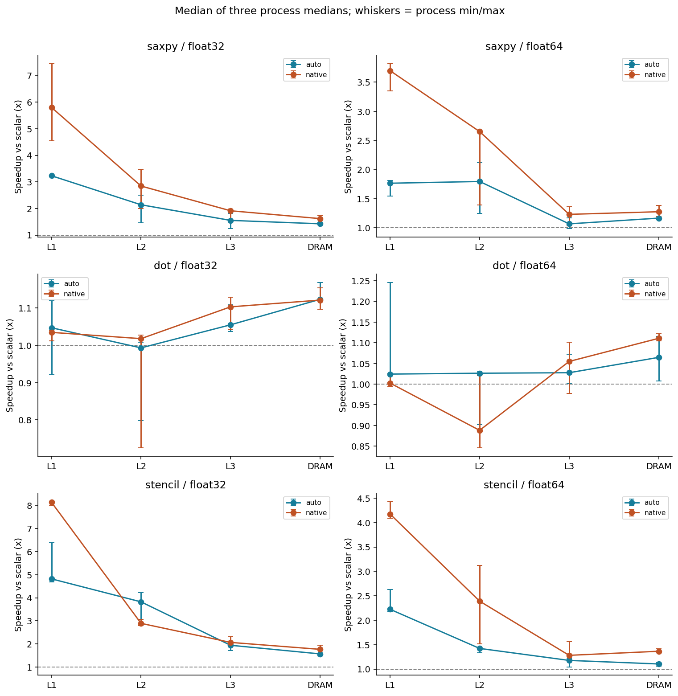
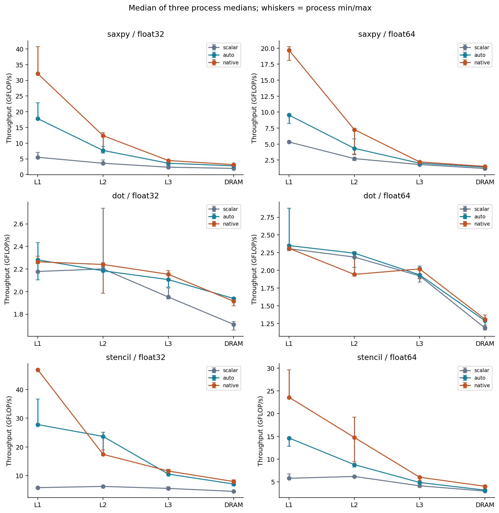
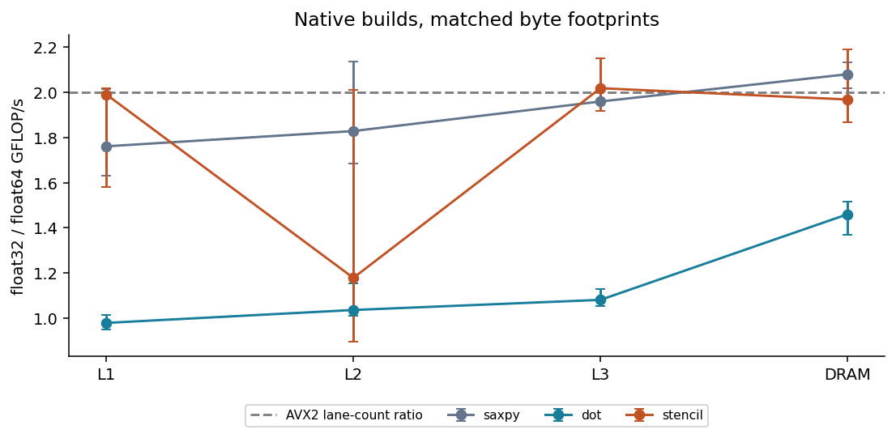
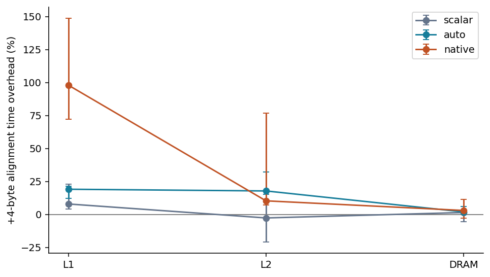
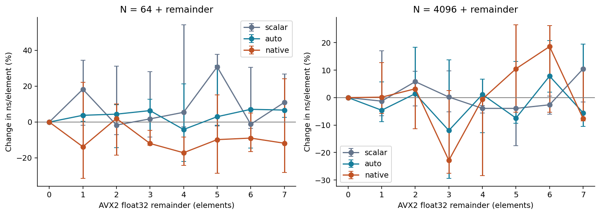
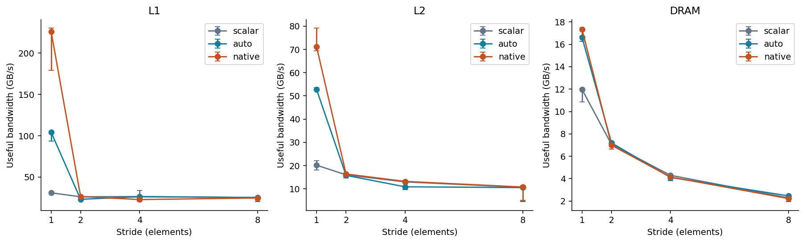
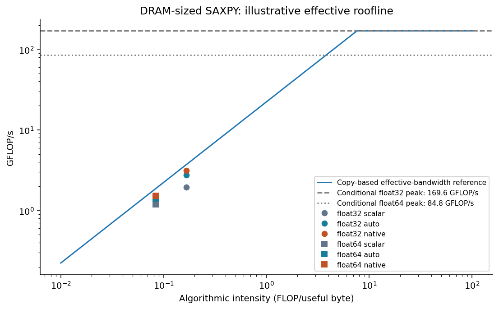

<style>
@media print {
  h1, h2, h3 { break-after: avoid; page-break-after: avoid; }
  h2 + p, h3 + p { break-after: avoid; page-break-after: avoid; }
  p:has(+ table) { break-after: avoid; page-break-after: avoid; }
  table { break-inside: avoid; page-break-inside: avoid; }
  thead { display: table-header-group; }
  tr { break-inside: avoid; page-break-inside: avoid; }
  img, .figure-caption { break-inside: avoid; }
  p:has(> img) { break-after: avoid; }
}
.cover-page { text-align: center; padding-top: 1.2in; min-height: 8in; break-after: page; page-break-after: always; }
.figure-caption { text-align: center; font-style: italic; }
</style>

<div class="cover-page" align="center">

<h2>ECSE 6320</h2>
<p>Advanced Computer Systems</p>
<br><br>
<h1>Project 1: SIMD Advantage Profiling</h1>
<br><br>
<p>Submitted by Rashid Shabab</p>

</div>

## Table of contents

- [1. Introduction](#1-introduction)
- [2. Grading rubric coverage](#2-grading-rubric-coverage)
- [3. Methodology](#3-methodology)
  - [3.1 Environment](#31-environment)
  - [3.2 Procedure](#32-procedure)
  - [3.3 Kernels, builds and metrics](#33-kernels-builds-and-metrics)
- [4. Scalar baselines and vectorization verification](#4-scalar-baselines-and-vectorization-verification)
  - [4.1 Scalar baselines](#41-scalar-baselines)
  - [4.2 Compiler reports and instruction evidence](#42-compiler-reports-and-instruction-evidence)
- [5. Working set and locality sweep](#5-working-set-and-locality-sweep)
  - [5.1 Working-set range](#51-working-set-range)
  - [5.2 Warm-up and execution state](#52-warm-up-and-execution-state)
- [6. Data type: float32 versus float64](#6-data-type-float32-versus-float64)
- [7. Alignment](#7-alignment)
- [8. Tail handling](#8-tail-handling)
- [9. Stride](#9-stride)
- [10. Peak throughput and host bottlenecks](#10-peak-throughput-and-host-bottlenecks)
  - [10.1 Effective memory roofline](#101-effective-memory-roofline)
  - [10.2 Conditional compute peak](#102-conditional-compute-peak)
  - [10.3 Interpreting the bottleneck](#103-interpreting-the-bottleneck)
- [11. Cycles per element](#11-cycles-per-element)
- [12. Misleading setups](#12-misleading-setups)
  - [12.1 A "vectorized" dot product that is not a parallel reduction](#121-a-vectorized-dot-product-that-is-not-a-parallel-reduction)
  - [12.2 A strided loop that silently stays scalar](#122-a-strided-loop-that-silently-stays-scalar)
  - [12.3 A native "slowdown" from a single-process run](#123-a-native-slowdown-from-a-single-process-run)
  - [12.4 Cache-resident "bandwidth" above DRAM speed](#124-cache-resident-bandwidth-above-dram-speed)
  - [12.5 TSC ticks reported as core cycles](#125-tsc-ticks-reported-as-core-cycles)
- [13. Anomalies](#13-anomalies)
- [14. Limitations](#14-limitations)
- [15. Reproducibility](#15-reproducibility)
- [16. Conclusion](#16-conclusion)
- [17. AI-use note](#17-ai-use-note)
  - [17.1 Division of work](#171-division-of-work)
  - [17.2 AI errors found during the project](#172-ai-errors-found-during-the-project)
  - [17.3 Claims that rest on the AI's judgement](#173-claims-that-rest-on-the-ais-judgement)
- [Appendix A. Full anomaly log](#appendix-a-full-anomaly-log)

## 1. Introduction

In this project, I measured how much SIMD vectorization speeds up three simple loops on my laptop's Intel Core Ultra 7 265H, running under WSL2. I compiled each kernel three ways: scalar (vectorization disabled), GCC's default auto-vectorization (SSE) and `-march=native` (AVX2 with FMA). For SAXPY in float32, the native build was 5.8× faster than scalar when the arrays fit in L1 cache, but only 1.6× faster when they came from DRAM. At that point it ran at about 85% of a copy-based memory-bandwidth reference. The strict dot product gained almost nothing from SIMD, because GCC kept its additions in order, one at a time.

| Metric | Result | Setting |
| --- | --- | --- |
| Best SAXPY SIMD speedup | 5.80× (32.1 GFLOP/s), 4.55–7.46× across processes | float32, native, L1 (32 KiB) |
| SAXPY SIMD speedup from DRAM | 1.62× (3.15 GFLOP/s), 1.58–1.73× across processes | float32, native, 76 MiB |
| Best overall SIMD speedup | 8.14× (46.9 GFLOP/s) | stencil, float32, native, L1 |
| Strict dot product speedup | 0.89–1.12× | all regions, both types, both vector builds |
| +4-byte misalignment cost | +98% time (72–149% across processes) | SAXPY float32 native, L1 |
| Stride 1 → 2 useful bandwidth | 226 → 26 GB/s (8.6× drop) | SAXPY float32 native, L1 |
| Copy-based memory bandwidth | 22.3 GB/s median (21.0–22.9 GB/s) | native `memcpy`, 80 and 160 MB |
| Correctness | 528 processes, 10,560 timed intervals, 0 failed checks | all experiments |

These were the main findings:

- The SIMD advantage shrinks as data moves farther from the core. For SAXPY float32 it falls from 5.8× (L1) to 2.85× (L2), 1.91× (L3) and 1.62× (DRAM). Once the arrays come from DRAM, the loop is limited by memory bandwidth, not arithmetic.
- A compiler message saying "loop vectorized" did not guarantee a speedup. The dot product's multiplies were vectorized, but its additions remained a serial chain, so throughput stayed near 2 GFLOP/s in every build.
- Misalignment mattered most where the data was fastest. A +4-byte shift nearly doubled native SAXPY time in L1, but changed DRAM time by only about 3%, within the noise.
- Any stride other than 1 made GCC use a scalar code path even with `-march=native`. Useful bandwidth then fell to scalar levels.
- float32 ran about twice as fast as float64 for SAXPY and the stencil, matching the 8-versus-4 lane ratio in most regions. For the dot product the ratio was about 1 in L1, consistent with a latency-bound loop.
- I could not measure actual core cycles: WSL does not expose the CPU's hardware performance counters. TSC ticks are reported separately and are not presented as core cycles.

## 2. Grading rubric coverage

The table below maps the implemented project requirements to the report and saved evidence. This is an evidence-coverage checklist, not an assertion of a grade or full rubric completion: actual hardware core cycles remain unavailable. Any additional instructor requirements should be checked against the assignment itself.

| Category | Requirement | Where in this report | Evidence |
| --- | --- | --- | --- |
| Baseline and correctness | Scalar baseline; correct results for every build | *Methodology*, *Scalar baselines and vectorization verification* | `-O3 -fno-tree-vectorize` scalar build; checks after every timed interval; separate reference validation for sizes 0–4097 and strides 1/2/4/8; ASan/UBSan runs for both data types |
| Vectorization verification | Show that SIMD is actually used | *Scalar baselines and vectorization verification* | GCC `-fopt-info-vec` reports and kernel disassembly for all six builds in `env/evidence/` |
| Locality sweep | SIMD speedup from L1 to DRAM | *Working set and locality sweep* | 3 kernels × 2 types × 3 builds × 4 working sets, 3 processes each; GFLOP/s and speedup with process min/max |
| Alignment and tail | Aligned versus misaligned; remainder handling | *Alignment*, *Tail handling* | Offset 0 versus +4 bytes in L1, L2 and DRAM; N = 64–71 and 4096–4103, covering every remainder mod 8 |
| Stride and data type | Effect of stride and element width | *Stride*, *Data type* | Strides 1/2/4/8 at fixed span; byte-matched float32 versus float64 |
| Roofline | Place kernels against memory and compute limits | *Peak throughput and host bottlenecks* | Measured copy bandwidth; arithmetic intensity of SAXPY; conditional compute peak with its assumptions stated |
| Cycles per element | Report cycles per element | *Cycles per element* | Attempted `perf_event_open`; unavailable under WSL. Gap: TSC ticks per element are reported separately and are not core cycles |
| Reproducibility | Scripts, raw data, repeated trials, environment | *Methodology*, *Reproducibility* | `scripts/run.py`, raw JSONL per process, `plan.json` and `environment.json` per experiment, 3 processes × 20 timed intervals |
| AI use and pitfalls | Honest AI-use note; misleading setups | *Misleading setups*, *Anomalies*, *AI-use note* | Five misleading setups or negative cases; anomaly log; division of work |

## 3. Methodology

I ran all experiments in a single pinned thread under WSL2 on my laptop. Each configuration ran as three separate processes, each with three warm-up intervals and 20 timed intervals.

### 3.1 Environment

| Item | Value |
| --- | --- |
| CPU | Intel Core Ultra 7 265H (hybrid performance and efficiency cores), up to 5.3 GHz turbo |
| Visible to WSL | 16 logical CPUs, 1 thread per core; flags include `avx2`, `fma`, `rdtscp`; no AVX-512 |
| Caches (as reported by WSL) | 48 KiB L1d and 3 MiB L2 per core, 24 MiB shared L3 |
| OS | Windows 11 with WSL2, Linux kernel 6.6.87.2 |
| Compiler | GCC 15.2.0 |
| Timer | `CLOCK_MONOTONIC_RAW` |
| Thread placement | One process, one thread, pinned to logical CPU 0 with `sched_setaffinity` |
| Hardware counters | Not available (`perf_event_open` returns ENOENT under WSL) |

The cache sizes are what WSL reports. The physical core behind logical CPU 0, and whether it was a performance or an efficiency core, could not be verified from inside the virtual machine.

### 3.2 Procedure

1. **Separate compilation.** The kernels are compiled in their own file with the flags above. The timing harness is compiled once at `-O2` and linked to each build, with no link-time optimization, so the compiler cannot hoist or merge repeated kernel calls.
2. **Inputs.** Inputs are periodic binary fractions (for SAXPY, a = 0.5, x = (i mod 17 − 8)/16, y = (i mod 13 − 6)/16), so results can be checked exactly. No fast-math flags are used.
3. **Timing.** Each timed interval calls the kernel a fixed number of times; time is divided by the number of calls. Initialization, resets and checks are outside the timed region.
4. **Correctness.** After every interval, the output is checked against a reference (long double for the dot product) and guard words around each array are checked for overwrites.
5. **Repetition.** Each configuration runs in 3 separate processes × 20 timed intervals, after 3 warm-up intervals. Process order is shuffled reproducibly for the locality sweep and alternated for the alignment, tail and stride studies.
6. **Statistics.** Each process reports its median interval. Tables show the median of the three process medians; ranges and error bars are the min and max of the process medians. They are not confidence intervals. Speedups are paired by process: process k of a vector build is compared with process k of the scalar build.
7. **Variability flag.** A process whose within-process coefficient of variation (CV) exceeds 15% is flagged but not discarded. 143 of 528 processes were flagged.
8. **Hypotheses.** Predictions were written to `report/HYPOTHESES.md` before the final sweeps. Each section below states the prediction and the outcome.

### 3.3 Kernels, builds and metrics

| Kernel | Operation | FLOPs per element | Useful bytes per element (w = element size) |
| --- | --- | --- | --- |
| SAXPY | y[i] = a·x[i] + y[i] | 2 | 3w (read x, read y, write y) |
| Dot product | s += x[i]·y[i], strict order | 2 | 2w |
| Stencil | out[i] = a·in[i−1] + b·in[i] + c·in[i+1] | 5 | 2w (assuming neighbouring inputs are reused) |

| Build | GCC flags | What it produces for SAXPY |
| --- | --- | --- |
| scalar | `-O3 -fno-tree-vectorize` | Scalar `mulss`/`addss` |
| auto | `-O3` | 128-bit SSE: 4 float32 lanes |
| native | `-O3 -march=native` | 256-bit AVX2 with FMA: 8 float32 or 4 float64 lanes |

| Region | Elements (float32) | Footprint (two arrays) |
| --- | --- | --- |
| L1 | 4,096 | 32 KiB |
| L2 | 262,144 | 2 MiB |
| L3 | 2,000,000 | 15.3 MiB |
| DRAM | 10,000,000 | 76.3 MiB |

float64 runs use half as many elements, so both types have the same byte footprint. The region names are intended cache levels, not measured residency.

## 4. Scalar baselines and vectorization verification

### 4.1 Scalar baselines

The scalar build is the reference for every speedup. It uses the same timing harness, inputs, checks, affinity and byte-matched working sets as the vector builds; only the kernel compiler flags differ. Disabling tree vectorization establishes the baseline, and scalar instructions in the saved disassembly (`env/evidence/`) verify it.

| Kernel | L1 scalar GFLOP/s | DRAM scalar GFLOP/s |
| --- | --- | --- |
| SAXPY | 5.49 | 1.95 |
| Strict dot product | 2.18 | 1.71 |
| Three-point stencil | 5.77 | 4.46 |

*Float32, medians of the three process medians, from `results/processed/final_summary.csv`. These are scalar throughput baselines, not new measurements.*

### 4.2 Compiler reports and instruction evidence

Before comparing timings, I checked which instructions each build actually used. A loop was counted as vectorized only when both GCC's report and the disassembly of the kernel showed packed instructions.

**What I expected:** SAXPY and the stencil vectorize in the auto and native builds; the strict dot product may vectorize its multiplies but keep its additions in order.

| Build / path | Instructions observed | Meaning |
| --- | --- | --- |
| float32 scalar SAXPY | `mulss`, `addss` | Scalar; using XMM registers alone does not mean SIMD |
| float32 auto SAXPY | `movups`, `mulps`, `addps` (XMM) | 4 float32 lanes, SSE |
| float32 native SAXPY | `vmovups`, `vfmadd213ps` (YMM) | 8 float32 lanes, AVX2 with FMA |
| float64 native SAXPY | `vmovupd`, `vfmadd213pd` (YMM) | 4 float64 lanes |
| float32 native, stride ≠ 1 | `vmovss`, `vfmadd213ss` | Scalar, despite `-march=native` |
| float32 native dot | `vmulps` (YMM), then a chain of `vaddss` | Packed multiplies, serial additions |
| float32 native stencil | `vmulps`, 2 × `vfmadd231ps` (YMM) | 8 outputs per iteration |

The expectation was confirmed. GCC reported "loop vectorized using 32 byte vectors" for the SAXPY, dot and stencil loops in the native build, and "couldn't vectorize loop" for the non-unit-stride SAXPY branch. The dot-product report is misleading on its own; Section 12.1 explains why. Full reports and disassembly are in `env/evidence/`, and excerpts are in `report/VECTORIZATION.md`.

## 5. Working set and locality sweep

### 5.1 Working-set range

I ran every kernel in every build at four working-set sizes. SIMD helped most in L1 and least from DRAM. For SAXPY float32, native speedup fell from 5.8× in L1 to 1.6× in DRAM.

**What I expected:** the largest SIMD advantage when data is in cache, shrinking toward DRAM, where memory bandwidth limits all builds. **Test settings:** 1 thread, aligned arrays, stride 1, 3 processes per point.

| Region | SAXPY f32 | SAXPY f64 | Dot f32 | Dot f64 | Stencil f32 | Stencil f64 |
| --- | --- | --- | --- | --- | --- | --- |
| L1 | 5.80× | 3.70× | 1.03× | 1.00× | 8.14× | 4.17× |
| L2 | 2.85× | 2.65× | 1.02× | 0.89× | 2.89× | 2.39× |
| L3 | 1.91× | 1.23× | 1.10× | 1.05× | 2.06× | 1.28× |
| DRAM | 1.62× | 1.28× | 1.12× | 1.11× | 1.76× | 1.36× |

*Native-build speedup over scalar, median of three paired processes.*

| Region | Scalar | Auto (SSE) | Native (AVX2) | Native speedup range |
| --- | --- | --- | --- | --- |
| L1 | 5.49 | 17.8 | 32.1 | 4.55–7.46× |
| L2 | 3.58 | 7.66 | 12.4 | 2.00–3.47× |
| L3 | 2.33 | 3.60 | 4.46 | 1.54–1.97× |
| DRAM | 1.95 | 2.77 | 3.15 | 1.58–1.73× |

*SAXPY float32 throughput in GFLOP/s. The full table for all kernels is in `results/processed/final_summary.csv`.*



<p align="center" class="figure-caption"><em>Figure 1. SIMD speedup over scalar by working-set region.</em></p>



<p align="center" class="figure-caption"><em>Figure 2. Throughput by working-set region.</em></p>

The results supported this expectation for SAXPY and the stencil:

- **In L1, SIMD is limited by the core, not memory.** Native SAXPY reached 5.8× instead of the ideal 8×. Each element still needs two loads and one store, and loop overhead and load/store throughput also limit the gain. The stencil gained more (8.14×) because each output reuses its neighbours' inputs and does more arithmetic per byte.
- **Auto-vectorization gets about half of the benefit.** The SSE build reached 3.2× for SAXPY in L1; native adds wider vectors and FMA. The native-versus-scalar comparison therefore changes the vector width, the instruction set and FMA contraction together, as the assignment intends. It does not isolate vector width alone.
- **From DRAM, all builds wait on memory.** Native SAXPY moved 18.9 GB/s of useful data, compared with 11.7 GB/s for scalar. The remaining 1.6× gain suggests the scalar build cannot issue requests fast enough to keep memory busy, while the native build comes close to the copy-based bandwidth (Section 10).
- **The dot product did not follow the pattern.** It stayed between 1.9 and 2.4 GFLOP/s from L1 to L3 in every build (Section 12.1).

High throughput in L1 means the cache hierarchy served the data quickly; it does not mean DRAM delivered it (Section 12.4).

### 5.2 Warm-up and execution state

Each process performs three warm-up intervals before the 20 recorded intervals. Repeated scans deliberately keep small working sets hot, while the largest working set exceeds the reported last-level cache. Initialization, output resets and correctness checks occur outside timing but can affect the next interval's cache state; this policy is shared across builds.

No cold-cache flush experiment, cold-start latency measurement or sustained thermal-state sweep was performed. The results describe this repeated-execution protocol. They do not establish a cold-versus-warm speedup or prove that the machine reached a fixed thermal or frequency state. The copy study uses two array sizes to provide an additional streaming reference rather than a cache-residency measurement.

## 6. Data type: float32 versus float64

With the same byte footprint, float32 ran about twice as fast as float64 for SAXPY and the stencil in most regions. The dot product showed no float32 advantage in cache.

**What I expected:** float32 is faster because AVX2 holds 8 float32 values versus 4 float64 values, but not necessarily exactly 2×. **Test settings:** native builds, byte-matched working sets, 3 processes per point.

| Region | SAXPY | Dot | Stencil |
| --- | --- | --- | --- |
| L1 | 1.76 (1.63–2.01) | 0.98 (0.95–1.01) | 1.99 (1.58–2.02) |
| L2 | 1.83 (1.68–2.14) | 1.04 (1.01–1.15) | 1.18 (0.90–2.01) |
| L3 | 1.96 (1.95–2.01) | 1.08 (1.06–1.13) | 2.02 (1.92–2.15) |
| DRAM | 2.08 (2.02–2.13) | 1.46 (1.37–1.51) | 1.97 (1.87–2.19) |

*Ratio of float32 to float64 GFLOP/s, median (min–max) across paired processes.*



<p align="center" class="figure-caption"><em>Figure 3. float32 / float64 throughput ratio for native builds.</em></p>

- **SAXPY and stencil: about 2×.** This matches the lane ratio. From DRAM it also matches the byte ratio: with the same bytes moved per second, float32 completes twice as many elements.
- **Dot product: about 1× in cache.** If each addition must wait for the previous one, lane count does not matter. A ratio near 1 is what a serial dependency chain predicts. From DRAM, the float64 version also waits on memory, so the ratio rises to 1.46.
- **The stencil L2 ratio is unreliable.** Its range of 0.90–2.01 comes from one slow native float32 L2 point (Appendix A, item 4).

## 7. Alignment

I compared 64-byte-aligned arrays with arrays shifted by one float (+4 bytes). Misalignment hurt most where the data was fastest: native SAXPY in L1 took about twice as long.

**What I expected:** AVX2 code in cache is the most sensitive to split accesses; in DRAM the difference may be hidden by memory time. **Test settings:** SAXPY float32, offsets 0 and +4 bytes, same allocation, N and flags; addresses verified mod 64; alternating order, 3 processes per point.

| Region | Scalar | Auto (SSE) | Native (AVX2) |
| --- | --- | --- | --- |
| L1 | +7.9% (+4.2 to +23.0) | +19.1% (+12.2 to +21.3) | +98.1% (+72.2 to +148.8) |
| L2 | −2.7% (−21.1 to +11.3) | +17.8% (+15.3 to +32.4) | +10.3% (+7.3 to +76.7) |
| DRAM | +1.4% (−5.4 to +1.4) | +1.9% (+0.6 to +6.0) | +3.0% (−2.7 to +11.2) |

*Extra time when shifted by +4 bytes, median (min to max) across paired processes. Positive means slower.*



<p align="center" class="figure-caption"><em>Figure 4. Time overhead of a +4-byte shift.</em></p>

The results supported this expectation:

- **Native in L1: nearly 2× slower.** With a +4-byte shift, every other 32-byte load or store crosses a 64-byte cache-line boundary. A load that spans two lines needs two cache accesses. This is a likely explanation, but I had no counters to measure split loads directly.
- **Wider vectors are more sensitive.** In L1 the penalty grew from scalar (+8%) to SSE (+19%) to AVX2 (+98%), consistent with the share of accesses that cross a line.
- **From DRAM, alignment barely matters.** All builds changed by 1–3%, within the process spread. The extra cache access is hidden behind memory time.
- **Scalar in L2 cannot be called a benefit.** The −2.7% median spans −21% to +11%, so it is noise.

## 8. Tail handling

When N is not a multiple of the vector width, the leftover elements need extra code. I tested every remainder from 0 to 7 elements and found no consistent penalty.

**What I expected:** remainder handling matters at small N and becomes negligible near N = 4096. **Test settings:** SAXPY float32, aligned arrays, stride 1, N = 64–71 and 4096–4103, 3 processes per point. Time per element is compared with the matching divisible N (64 or 4096).

| Base N | Scalar (ns/element) | Auto (ns/element) | Native (ns/element) | Native change across remainders 1–7 |
| --- | --- | --- | --- | --- |
| 64 | 0.634 | 0.122 | 0.128 | −17% to +2% |
| 4096 | 0.380 | 0.114 | 0.053 | −23% to +19% |



<p align="center" class="figure-caption"><em>Figure 5. Change in time per element for each remainder.</em></p>

The hypothesis was not clearly supported:

- **The tail code exists.** The native SAXPY disassembly has a YMM main loop, an XMM path for 4 leftover elements and scalar `vfmadd...ss` instructions for the rest.
- **Its cost was smaller than the measurement noise.** At N = 64 most native remainders were slightly *faster* per element than N = 64, and at N = 4096 the changes ranged from −23% to +19% with no order by remainder size. A tail of at most 7 scalar elements is a few nanoseconds, comparable to the run-to-run variation.
- **Call overhead dominates small N.** Native time per element at N = 64 (0.128 ns) is more than twice that at N = 4096 (0.053 ns). The fixed cost of each call is spread over few elements, which hides the remainder.

## 9. Stride

I accessed every 1st, 2nd, 4th or 8th element while keeping the allocated span the same. Any stride other than 1 removed most of the SIMD advantage, because GCC used a scalar loop.

**What I expected:** useful bandwidth falls as fewer used values share each cache line; a runtime stride may also prevent vectorization. **Test settings:** SAXPY float32, strides 1/2/4/8, N = span / stride, fixed span in L1, L2 and DRAM; only useful updates are counted; 3 processes per point.

| Region | Build | Stride 1 | Stride 2 | Stride 4 | Stride 8 |
| --- | --- | --- | --- | --- | --- |
| L1 | scalar | 30.9 | 26.1 | 26.4 | 25.2 |
| L1 | native | 226.3 | 26.4 | 22.7 | 24.7 |
| L2 | scalar | 20.2 | 16.0 | 13.0 | 10.6 |
| L2 | native | 71.2 | 16.4 | 13.2 | 10.7 |
| DRAM | scalar | 12.0 | 7.1 | 4.3 | 2.3 |
| DRAM | native | 17.4 | 7.0 | 4.1 | 2.2 |

*Useful bandwidth in GB/s, median of 3 processes. Auto-build values are in the figure.*



<p align="center" class="figure-caption"><em>Figure 6. Useful bandwidth versus stride.</em></p>

The results supported both parts of the expectation:

- **SIMD disappears at stride 2.** In L1, native fell from 226 to 26 GB/s, the same as scalar. The disassembly shows why: the strided branch uses scalar `vfmadd213ss`, and GCC reported "couldn't vectorize loop" for it.
- **In L1 and L2, the loss is mostly the instruction path.** Scalar bandwidth changes little from stride 1 to stride 8 in L1, so cache-line waste is not what limits it there.
- **In DRAM, cache-line waste dominates.** Bandwidth roughly halves with each doubling of stride for every build, because each 64-byte line brought from memory carries fewer useful values.
- **What this does not show.** The study measures the combined effect of wasted cache-line space and scalar code. It does not show that strided code can never be vectorized: AVX2 gather instructions exist, but GCC did not use them here.

## 10. Peak throughput and host bottlenecks

### 10.1 Effective memory roofline

The roofline model compares a kernel's performance with two limits: memory bandwidth × arithmetic intensity, and peak compute. Native SAXPY from DRAM reached about 85% of the memory limit and about 2% of a conditional compute peak, so it is memory-bound.

**What I expected:** SAXPY's low arithmetic intensity makes it memory-bound for large arrays. **Test settings:** native `memcpy`-based copy over 80 MB and 160 MB, 3 processes each, on the same pinned CPU.

| Quantity | float32 | float64 |
| --- | --- | --- |
| Arithmetic intensity (FLOP per useful byte) | 2 / 12 = 0.167 | 2 / 24 = 0.083 |
| Memory limit at 22.3 GB/s | 3.72 GFLOP/s | 1.86 GFLOP/s |
| Measured native SAXPY, DRAM | 3.15 GFLOP/s (85%) | 1.52 GFLOP/s (82%) |
| Conditional compute peak | 169.6 GFLOP/s | 84.8 GFLOP/s |



<p align="center" class="figure-caption"><em>Figure 7. DRAM-sized SAXPY on an effective roofline.</em></p>

The results supported this expectation:

- **The memory limit is an effective reference, not a hardware maximum.** The copy benchmark measured 21.0–22.9 GB/s of useful read plus write traffic. `memcpy` may use different store instructions than SAXPY, and write-allocate traffic is not counted, so this line is a workload-based reference.
### 10.2 Conditional compute peak

- **The compute peak is an estimate with stated assumptions.** It assumes a performance core issuing two 256-bit FMAs per cycle at the 5.3 GHz maximum turbo: 2 × 8 lanes × 2 FLOPs × 5.3 GHz = 169.6 GFLOP/s. Intel's [Lion Cove architecture material](https://cdrdv2-public.intel.com/824430/2024_Intel_Tech%20Tour%20TW_Next%20Gen%20P-core%20The%20Lion%20Cove%20Architecture-4.pdf) shows two FMA units, and the [265H specification](https://www.intel.com/content/www/us/en/products/sku/241750/intel-core-ultra-7-processor-265h-24m-cache-up-to-5-30-ghz/specifications.html) gives the 5.3 GHz turbo. The actual core type and sustained AVX frequency of CPU 0 were not measured, so the real peak may be lower.
- **The conclusion holds under any reasonable peak.** Even at one-quarter of the estimate, SAXPY from DRAM sits far below the compute limit and close to the memory line.

### 10.3 Interpreting the bottleneck

The largest observed native float32 stencil throughput is 46.9 GFLOP/s in L1, while DRAM-sized SAXPY reaches about 3.15 GFLOP/s. These are peaks within the measured single-thread configurations. They are not the processor's maximum all-core throughput.

The effective roofline and the shrinking SIMD advantage support a memory-service interpretation for large SAXPY arrays. The strict dot product instead has a verified serial accumulation path. Frequency changes, hybrid-core placement and virtualization can also limit the host. No thread-count sweep, measured operating-frequency correlation or hardware-traffic counter isolates those contributions, so the report does not identify a measured host-saturation knee.

## 11. Cycles per element

I could not measure actual core cycles. The benchmark requests `PERF_COUNT_HW_CPU_CYCLES` through `perf_event_open` for its own thread, and WSL returns ENOENT (event not available). The `perf` tool is also missing, and installing it would not add the missing hardware counter support.

Missing core-cycle values are stored as −1 and never replaced with estimates. As a separate metric, the benchmark records invariant TSC ticks per element using `rdtscp`. The TSC counts at a fixed reference rate and keeps counting while the thread is descheduled, so it measures elapsed time in ticks, not cycles the core actually executed (Section 12.5). For example, native SAXPY float32 used 0.23 TSC ticks per element in L1 and 2.34 from DRAM; scalar used 1.34 and 3.79. These values are in `results/processed/final_summary.csv`. Filling the core-cycle column requires rerunning the same runner on native Linux with hardware counter access.

## 12. Misleading setups

During the project, I found five setups where a measurement or a tool output could easily be misread. Two are verified negative cases for SIMD, one is a historical result that did not reproduce, and two are reporting pitfalls.

### 12.1 A "vectorized" dot product that is not a parallel reduction

GCC reported "loop vectorized using 32 byte vectors" for the strict dot product. The disassembly shows packed `vmulps` for the multiplies, followed by a chain of scalar `vaddss` for the additions. Without `-ffast-math`, GCC must add the products in their original order, because floating-point addition is not associative. Each addition waits for the previous one, so the loop is limited by addition latency, not by vector width.

The measurements agree. Native dot speedup was 0.89–1.12× in every region, throughput stayed near 2 GFLOP/s from L1 to L3, and the float32/float64 ratio was about 1 in L1 (Section 6). A compiler "vectorized" message is not evidence of a SIMD speedup.

### 12.2 A strided loop that silently stays scalar

The SAXPY source looks easy to vectorize at any stride, and the build used `-march=native`. However, the stride is a runtime value, and GCC generated a scalar loop for every stride other than 1. Without checking the disassembly, the stride results could be blamed entirely on cache-line waste. In L1, the drop from 226 to 26 GB/s is mostly lost SIMD (Section 9).

### 12.3 A native "slowdown" from a single-process run

An earlier version of the benchmark, not included in the final repository, measured native SAXPY from DRAM at 1.83 GFLOP/s against 2.19 for scalar, an apparent 0.84× slowdown. That version ran each configuration in one process. In the final version, with three paired processes, native float32 DRAM speedup was 1.58–1.73×, with no process below scalar. A single process at DRAM size is too noisy to support a claim that native code is slower, and the earlier result is not used.

### 12.4 Cache-resident "bandwidth" above DRAM speed

Native SAXPY in L1 moved 226 GB/s of useful data, ten times the 22.3 GB/s copy bandwidth. This is not an error: when arrays fit in L1, the cache serves them. Reporting such a number as "memory bandwidth" would overstate the memory system. In this report, bandwidth is always useful bytes per second counted from the algorithm, and only DRAM-sized runs are compared with the copy reference.

### 12.5 TSC ticks reported as core cycles

An easy shortcut is to multiply wall time by a nominal clock frequency, or to read the TSC, and call the result "cycles". Both give a reference-clock count that does not follow turbo, frequency changes or descheduling. I reported TSC ticks in a separate, clearly labelled column and left the core-cycle column empty (−1) rather than mixing the two.

## 13. Anomalies

I kept track of results that were unexpected or inconsistent between processes instead of removing them. Appendix A lists all ten with their data, likely causes and handling. The four that most affect how the results should be read are:

- **High within-process variability.** 143 of 528 processes had CV above 15%. The L3 region was flagged most often (39% of locality processes) and DRAM least (7%). This is why every table shows process ranges.
- **Large spread at the best-case point.** Native SAXPY float32 in L1 gave 4.55×, 5.80× and 7.46× in its three processes, so "5.8×" should be read as a typical value, not an exact one.
- **Native was slower than auto for the float32 stencil in L2** (17.4 versus 23.6 GFLOP/s). The cause was not established.
- **The earlier native DRAM slowdown did not reproduce** (Section 12.3).

## 14. Limitations

The biggest limitation was running under WSL2. It prevented hardware cycle counts and left CPU frequency, core type and host activity outside my control. Comparisons between builds measured in the same experiment are more reliable than any single absolute number.

| Limitation | Effect on results | Mitigation |
| --- | --- | --- |
| No hardware counters under WSL | No core cycles per element; cache-line splits and memory traffic could not be measured directly | TSC ticks reported separately; explanations marked as likely |
| CPU frequency and turbo not controlled | Run-to-run variation; 143/528 processes above 15% CV | 3 separate processes per point; process min/max shown; order shuffled or alternated |
| Hybrid CPU, physical core unknown | CPU 0 may map to a performance or efficiency core; the compute peak is conditional | Pinned to one logical CPU; peak stated with its assumptions |
| Cache sizes as reported by WSL | Region names are intended cache levels, not measured residency | Working sets chosen well inside or well beyond each level |
| Native flags change several things at once | Native versus scalar mixes vector width, instruction set and FMA | Auto build shown separately; disassembly recorded |
| Copy-based bandwidth reference | The memory line in the roofline is effective, not a hardware maximum | Stated as a reference; all copy samples kept |
| Fixed-span stride study | Useful work changes with stride; cache waste and scalar code are measured together | Only useful updates counted; scalar build shown for comparison |
| Exact-friendly inputs | Correctness checks do not cover arbitrary data | Separate randomized reference and sanitizer validation |
| Only 3 processes per point | Ranges, not confidence intervals | Stated in the methodology |

## 15. Reproducibility

The repository stores the source code, build commands, raw measurements and environment for every experiment. Exact numbers may differ on another run because CPU frequency and host activity were not controlled.

| Path | Contents |
| --- | --- |
| `src/kernels_v3.c`, `src/kernels_v3.h` | The three kernels (SAXPY, dot, stencil) |
| `src/bench_v3.c`, `src/validate_v3.c` | Timing harness and reference validation |
| `scripts/run.py` | Builds the six variants, records compiler evidence and runs each study |
| `scripts/verify.py` | Reference validation and ASan/UBSan runs |
| `analysis/analyze.py` | Processed CSVs, the seven figures and `results/processed/generated_tables.md` |
| `scripts/export_report.py` | Converts this report to LaTeX and PDF |
| `results/raw/<timestamp>_<study>/` | `plan.json`, `environment.json`, `hypotheses.md`, raw JSONL with every interval, per-process `summary.csv` |
| `results/processed/` | `final_summary.csv`, `locality_analysis.csv`, `alignment_analysis.csv`, `tail_analysis.csv` |
| `env/evidence/` | Build commands, vectorization reports, disassembly, validation output |
| `figures/` | All figures in this report |

To reproduce, from the project folder on Linux or WSL with GCC, binutils and Python 3:

```
python scripts/run.py build
python scripts/verify.py
python scripts/run.py locality --trials 3 --cpu 0
python scripts/run.py alignment --trials 3 --cpu 0
python scripts/run.py tail --trials 3 --cpu 0
python scripts/run.py stride --trials 3 --cpu 0
python scripts/run.py bandwidth --trials 3 --cpu 0
python analysis/analyze.py
python scripts/export_report.py --engine pdflatex
```

The final measurements are in these runs, all on 2 October 2026: `20261002T174534912678Z_locality`, `20261002T175152018564Z_alignment`, `20261002T174324539136Z_tail`, `20261002T174359082719Z_stride` and `20261002T175228227801Z_bandwidth`.

## 16. Conclusion

The main lesson from this project is that a SIMD speedup depends as much on where the data lives as on the vector width. In L1, AVX2 made SAXPY 5.8× faster and the stencil 8.1× faster. From DRAM, every build waited on memory, and the native build's 1.6× gain brought SAXPY to about 85% of the measured copy bandwidth.

The negative cases were as informative as the speedups. A "vectorized" dot product gained nothing because its additions stayed serial; a stride of 2 turned the native build back into scalar code; and a +4-byte shift nearly doubled native time in L1. In each case, the compiler's report or the source code alone would have given the wrong impression, and the disassembly and paired measurements were needed to explain the result.

If I repeated the project, I would run it on native Linux to obtain core cycles and cache-line split counts, pin the thread to a known performance core with a fixed frequency, add an unordered (`-ffast-math` or manually split) dot-product variant to measure the reduction directly, and use more than three processes per point.

## 17. AI-use note

I used AI assistants throughout this project. OpenAI Codex helped write the final (version 3) benchmark code, the build and run scripts, the compiler-evidence collection, the analysis and plotting script and the first version of this report. Claude, an AI assistant from Anthropic, later checked the report's numbers against the processed and raw data and restructured the report into its current format. Every number in this report comes from the measurement files stored in the repository.

### 17.1 Division of work

| Stage | What the AI did | What I did |
| --- | --- | --- |
| Learning | Explained SIMD, vector lanes, alignment, tails, roofline and the difference between TSC ticks and core cycles | Asked questions and chose what to study |
| Early versions | — | Ran the version 1 and 2 SAXPY benchmarks on my laptop |
| Final code | Recovered the runner, wrote the version 3 kernels, harness, validation, `run.py`, `verify.py` and `analyze.py` | Ran them in my WSL environment and reviewed the results |
| Experiment design | Proposed the three kernels, byte-matched working sets, paired processes, alignment, tail and stride studies, and the hypotheses | Approved the design and the set of experiments |
| Analysis | Computed summaries, paired speedups and the roofline; inspected disassembly; wrote interpretations | Reviewed the interpretations |
| Writing | Drafted the report and README; restructured and checked this version | Reviewed, edited and finalised them |

### 17.2 AI errors found during the project

The table below records workflow and interpretation problems documented in the project files, and how the AI-assisted work was corrected. It does not establish that AI alone caused every problem. Earlier measurement limitations are distinguished from errors in report generation.

| # | What went wrong | How it was caught | Outcome |
| --- | --- | --- | --- |
| 1 | An earlier version reported native SAXPY as slower than scalar from DRAM, based on one process per configuration | The final version repeated the test with three paired processes | Not reproduced; described as a misleading setup (Section 12.3) |
| 2 | The measured runner from an earlier session was not saved | Found when the code was reorganized | Recovered; source hashes kept in each run's `environment.json` |
| 3 | The analysis script overwrote `Report.md` every time it ran, which would erase manual edits | Found while revising this report | The script now writes its tables to `results/processed/generated_tables.md` |

### 17.3 Claims that rest on the AI's judgement

- Explanations marked *likely* (cache-line splits for the alignment penalty, the scalar build not keeping memory busy, the dot product being limited by addition latency) are interpretations of the data. They were not confirmed with hardware counters.
- The conditional compute peak relies on Intel's published turbo frequency and architecture material, not on a measurement of CPU 0.

## Appendix A. Full anomaly log

Inferred causes should be read as explanations supported by the measurements, rather than direct proof.

| # | Anomaly | Data | Likely cause | Handling |
| --- | --- | --- | --- | --- |
| 1 | Many processes exceeded the 15% CV flag | 143 of 528; by region in the locality sweep: L3 39%, L1 20%, L2 17%, DRAM 7% | Uncontrolled frequency, WSL scheduling and host activity; short intervals in L1 | Kept; medians and process ranges reported |
| 2 | Large spread at native SAXPY float32 L1 | Speedup 4.55×, 5.80×, 7.46× across processes; one process had 46% CV | Each L1 interval lasts about 1 ms, so it is sensitive to frequency changes and interrupts | Median and range reported |
| 3 | Dot product shows no SIMD gain | 0.89–1.12× in all regions and types | Strict in-order additions form a serial dependency chain | Reported as a verified negative case (Section 12.1) |
| 4 | Native slower than auto for the float32 stencil in L2 | Native 17.3–19.0 GFLOP/s, auto 19.0–25.2 GFLOP/s | Not established; auto also had high CV (22–26%) in two processes | Reported as an observation; stencil L2 datatype ratio marked unreliable |
| 5 | Native slower than scalar for the float64 dot product in L2 | 0.89× median (0.85–1.02×) | Within the noise of a loop with no real SIMD gain | Not interpreted as a real slowdown |
| 6 | Native float32 tail remainders faster per element than N = 64 | −17% to +2% for remainders 1–7 | Call overhead spread over more elements, plus noise | Reported; no tail penalty claimed |
| 7 | Scalar SAXPY in L2 appears faster when misaligned | −2.7% median, −21.1% to +11.3% | Noise | Not called a benefit |
| 8 | Historical native DRAM slowdown | Earlier version: native 1.83 vs scalar 2.19 GFLOP/s, one process | Single-process measurement at DRAM size | Not reproduced; final value 1.58–1.73× speedup |
| 9 | L1 useful bandwidth far above copy bandwidth | 226 GB/s versus 22.3 GB/s | L1 cache serves the data | Explained in Section 12.4 |
| 10 | No core-cycle measurements | `perf_event_open` returns ENOENT under WSL | WSL does not expose the hardware counters | TSC ticks reported separately; requirement listed as a gap |
