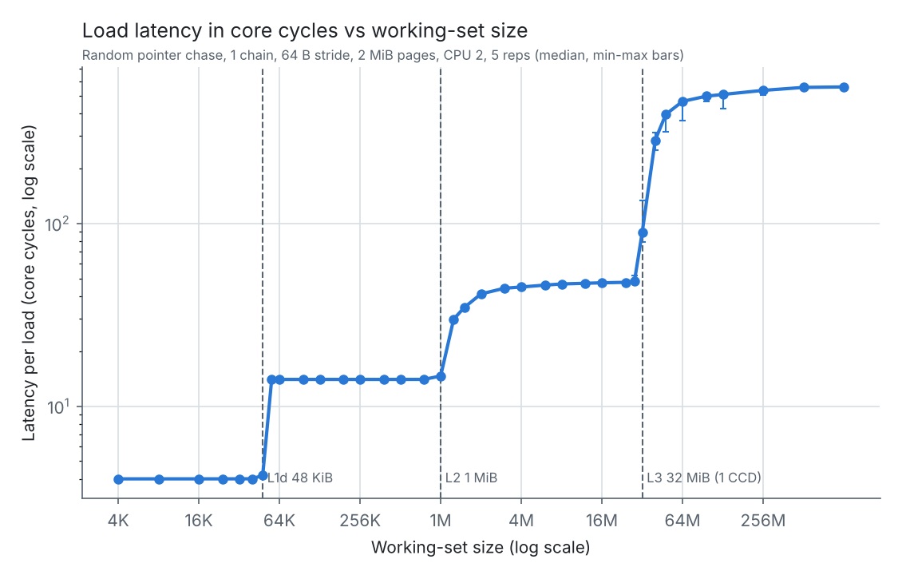
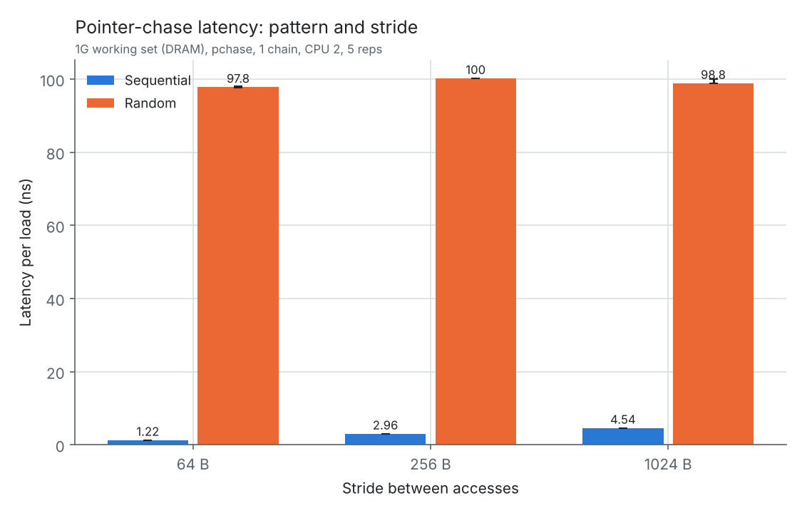
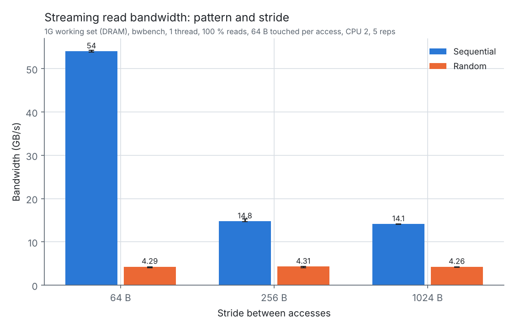
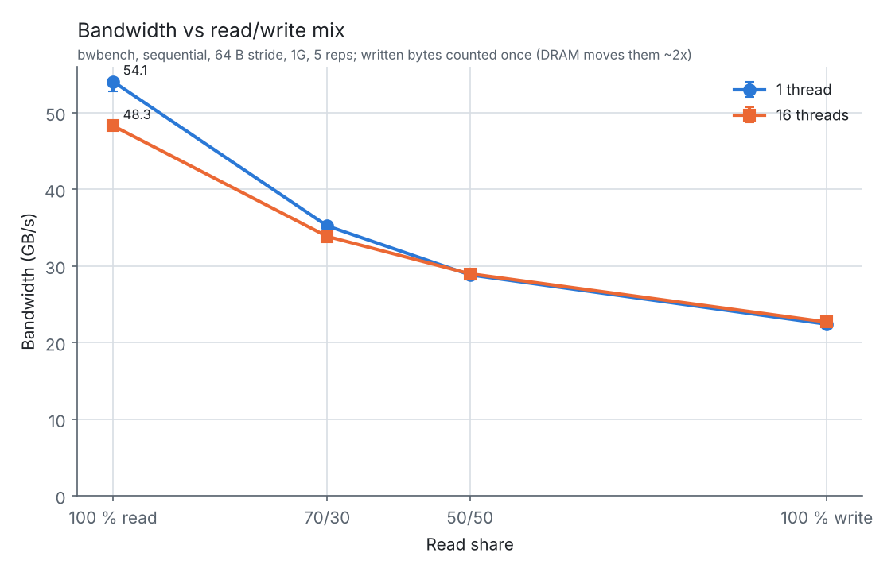
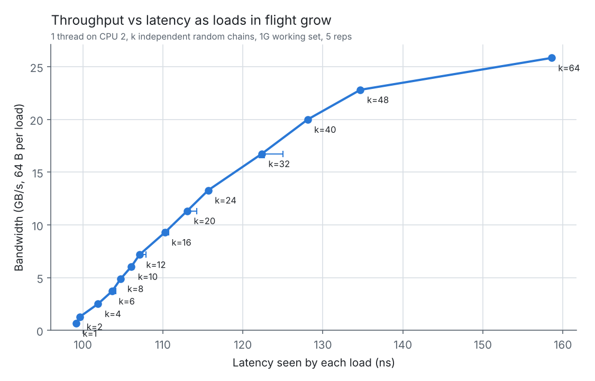
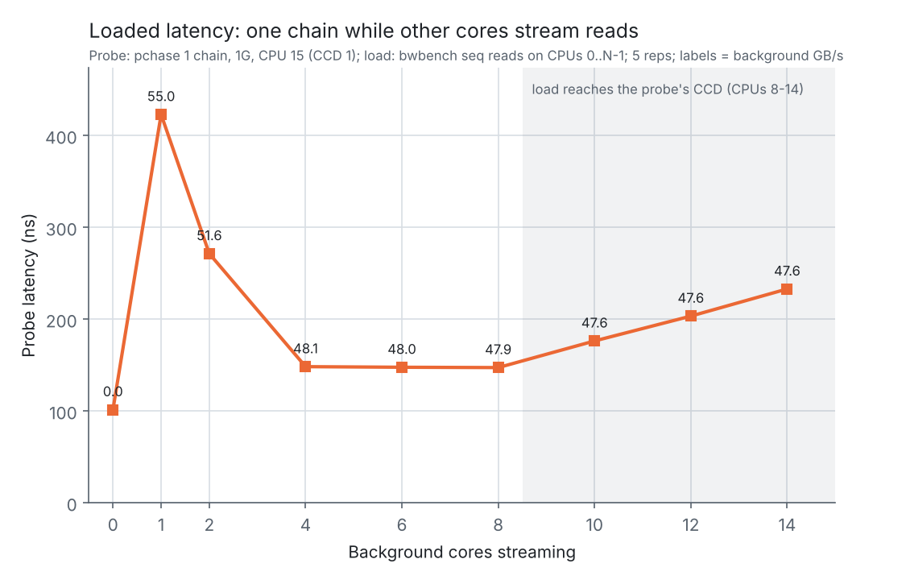
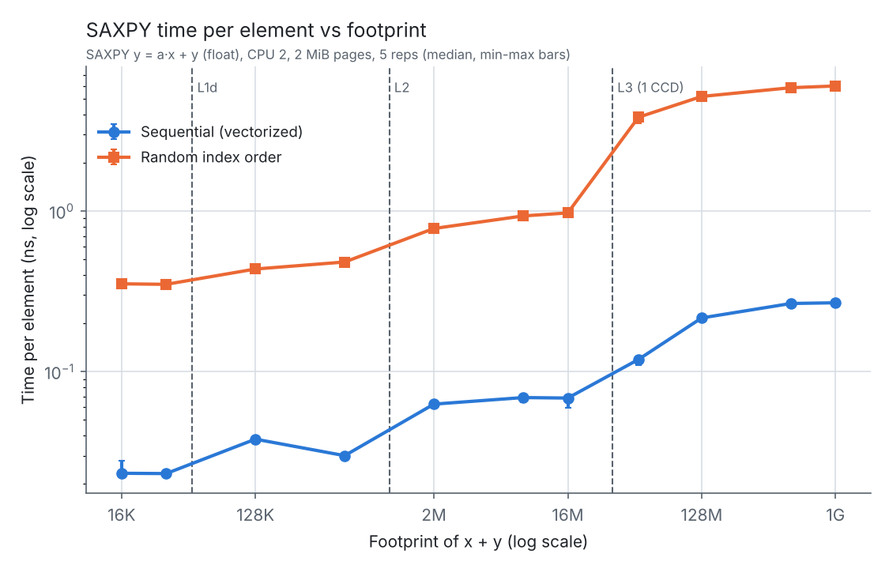
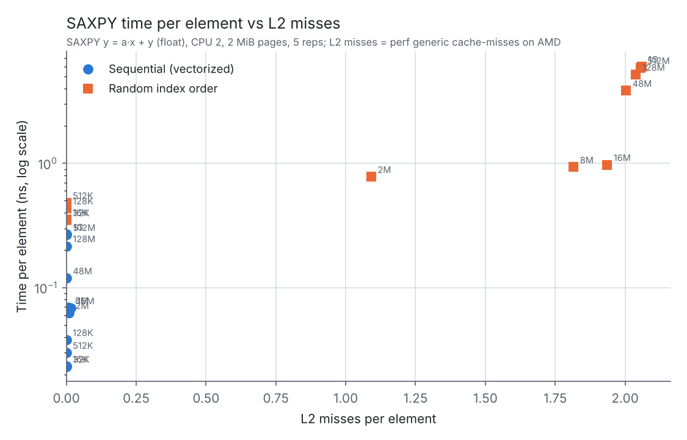
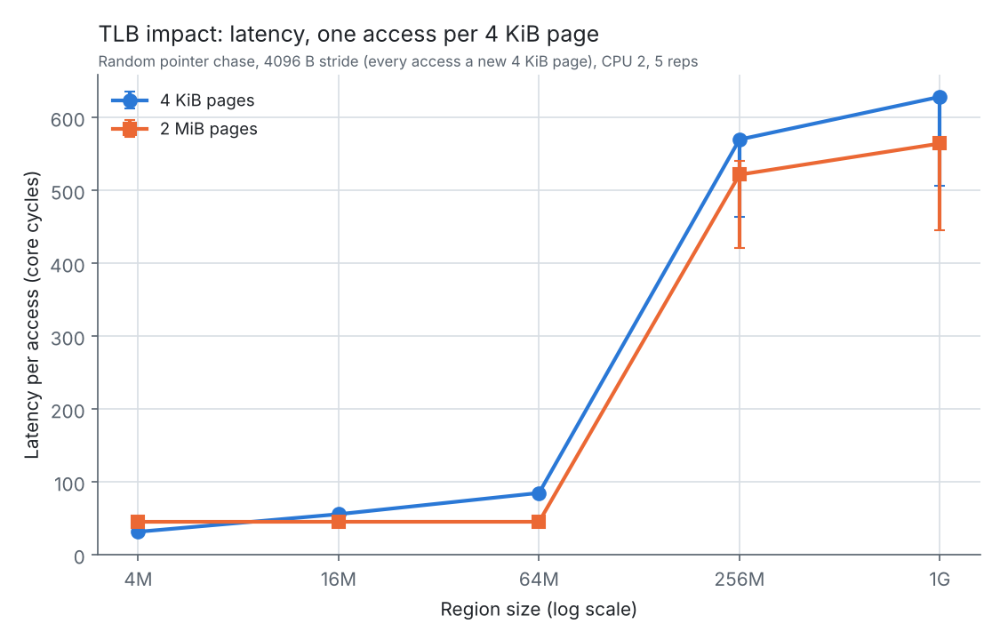
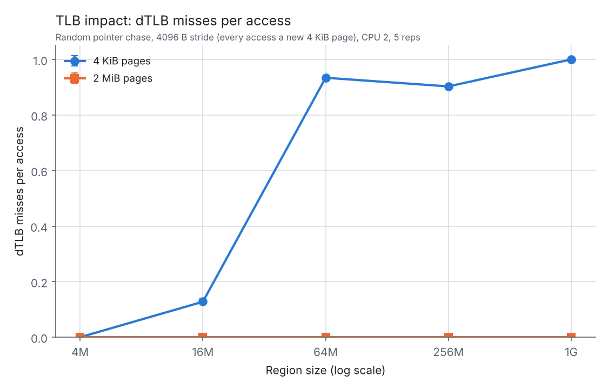

<style>
@media print {
  h1, h2, h3 { break-after: avoid; page-break-after: avoid; }
  h2 + p, h3 + p { break-after: avoid; page-break-after: avoid; }
  p:has(+ table) { break-after: avoid; page-break-after: avoid; }
  table { break-inside: avoid; page-break-inside: avoid; }
  thead { display: table-header-group; }
  tr { break-inside: avoid; page-break-inside: avoid; }
  img, .figure-caption { break-inside: avoid; }
  p:has(> img) { break-after: avoid; }
}
.cover-page { text-align: center; padding-top: 1.2in; min-height: 8in; break-after: page; page-break-after: always; }
.figure-caption { text-align: center; font-style: italic; }
</style>

<div class="cover-page" align="center">

<h2>ECSE 6320</h2>
<p>Advanced Computer Systems</p>
<br><br>
<h1>Project 2: Cache &amp; Memory Performance Profiling</h1>
<br><br>
<p>Submitted by Rashid Shabab</p>

</div>

## Table of contents

1. [Introduction](#1-introduction)
2. [Grading rubric coverage](#2-grading-rubric-coverage)
3. [Methodology](#3-methodology)
4. [Zero-queue baselines](#4-zero-queue-baselines)
5. [Working-set sweep](#5-working-set-sweep)
6. [Pattern and granularity sweep](#6-pattern-and-granularity-sweep)
7. [Read/write mix sweep](#7-readwrite-mix-sweep)
8. [Intensity sweep: the knee and Little's Law](#8-intensity-sweep-the-knee-and-littles-law)
9. [Cache-miss impact (SAXPY)](#9-cache-miss-impact-saxpy)
10. [TLB-miss impact](#10-tlb-miss-impact)
11. [Benchmark pitfalls and misleading setups](#11-benchmark-pitfalls-and-misleading-setups)
12. [Anomalies](#12-anomalies)
13. [Limitations](#13-limitations)
14. [Reproducibility](#14-reproducibility)
15. [Conclusion](#15-conclusion)
16. [AI-use note](#16-ai-use-note)

## 1. Introduction

In this project, I measured the cache and memory hierarchy of an AMD Ryzen 9 9950X (Zen 5) running CachyOS Linux.
Intel MLC only partly works on AMD and several of its modes need root, which I did not have, so I used three small C
benchmarks written for this project instead: a pointer-chase latency benchmark (`pchase`), a streaming bandwidth
benchmark (`bwbench`) and a SAXPY kernel (`saxpy`). All three pin themselves to a core, control the page size, read
hardware counters around the timed loop only, and check their own correctness before timing.

| Metric | Result | Setting |
|---|---|---|
| L1 / L2 / L3 load-to-use latency | 4.0 / 14.0 / 47.3 cycles | Random pointer chase, 32 KiB / 512 KiB / 16 MiB |
| DRAM latency | 97.9 ns (559 cycles at 5.71 GHz) | Random pointer chase, 1 GiB |
| Effective L3 capacity for one core | 32 MiB (not the chip's 64 MiB) | Working-set sweep |
| Single-core DRAM bandwidth | 54.1 GB/s sequential read; 4.3 GB/s random | 1 GiB, 1 thread |
| Single-core knee | ~48 misses in flight, ~26 GB/s random; latency 99 → 159 ns at 64 | 1–64 independent chains |
| Loaded latency | 101 ns idle → 423 ns with one streaming core (55 GB/s) | Probe on CPU 15 |
| TLB miss cost (4 KiB pages) | 42–64 cycles per miss, growing with region size | One access per page, 64 MiB–1 GiB |

These were the main findings:

- The latency staircase steps exactly at the documented capacities: 48 KiB (L1), 1 MiB (L2) and 32 MiB (one CCD's L3).
  In cycles, cache latency is unaffected by the clock; in nanoseconds it is not, because the core ran at either
  4.37 GHz or 5.71 GHz depending on the run.
- One core can keep about 48 independent misses in flight before latency rises faster than throughput. Little's Law
  ties the benchmarks together: random SAXPY implies ~34 misses in flight, matching the 32-chain point of the chain sweep.
- Near memory saturation, a 15% rise in background bandwidth (48 → 55 GB/s) nearly tripled the latency of an
  unrelated load (148 → 423 ns).
- Writes cost about twice their bytes in DRAM traffic (read-for-ownership plus write-back). Counting that, total traffic
  stayed at 43–54 GB/s for every read/write mix.
- With 4 KiB pages, the TLB covers roughly 14 MiB; past that, every access needs a page walk that costs about one L3 hit.
- Miss counters can mislead: sequential SAXPY slowed down 12× from L1 to DRAM with almost no L2 demand misses,
  because the prefetchers turned the misses into hits.

## 2. Grading rubric coverage

| Rubric category (points) | Where it is covered |
|---|---|
| Zero-queue baselines (25) | §4: per-level table in ns and cycles with the measured clock, min–max over 10 runs, caveats |
| Pattern / granularity / RW sweeps (35) | §6 (seq vs random × 64/256/1024 B, latency and bandwidth), §7 (four mixes, 1 and 16 threads) |
| Throughput–latency knee (35) | §8: chain sweep (1–64), knee, diminishing returns, Little's Law, loaded latency |
| Working-set / cache / TLB analysis (35) | §5 (staircase, AMAT), §9 (SAXPY counters vs runtime, correlations), §10 (dTLB counters, 4 KiB vs 2 MiB) |
| Experimental rigor (25) | §3: pinning, warm-up, repetitions, in-process counters, self-validation, recorded environment, `membench.py` |
| AI-use transparency and pitfall (15) | §11 (six pitfalls, each demonstrated with data), §16 (AI-use note) |
| Report quality (15) | Figures with units and min–max bars, §12 anomalies, §13 limitations |

## 3. Methodology

### 3.1 Environment

| Item | Value |
|---|---|
| CPU | AMD Ryzen 9 9950X (Zen 5, family 26 model 68), 16 cores / 32 threads, 1 socket |
| Caches | L1d 48 KiB/core (12-way, 64 sets), L2 1 MiB/core (16-way), L3 32 MiB per CCD × 2 (16-way), 64 B lines |
| Topology | CCD 0 = CPUs 0–7, CCD 1 = CPUs 8–15; SMT siblings 16–31; 1 NUMA node |
| Memory | 60 GiB DRAM; speed grade and channel count not readable without root (unknown) |
| OS / kernel | CachyOS, Linux 7.3.0-2-cachyos |
| Frequency | `amd-pstate-epp` driver, `powersave` governor, EPP `balance_performance`, boost on; not changeable (no root). Observed 4.37 or 5.71 GHz during runs |
| SMT | On; the sibling of the measuring core (CPU 18 for CPU 2) was left idle |
| Pages | Transparent huge pages `always`; each benchmark sets 4 KiB or 2 MiB pages explicitly with `madvise` |
| Compiler | GCC 16.2.1; `pchase` `-O2 -march=native`, `bwbench` and `saxpy` `-O3 -march=native` |
| Counters | `perf_event_open` inside the benchmarks (user space only, `perf_event_paranoid` = 2); perf 7.2.11 for spot checks |
| Access | Shared lab workstation over SSH, standard user, no root; load average 0.06–0.72 at session starts |

Every result session also stores a full environment snapshot (`env.txt`) and a `manifest.json` with the exact commands,
compiler and perf versions, timestamps and the hypothesis.

### 3.2 Benchmarks and validation

**`pchase` (latency).** Builds a chain of pointers through a buffer in shuffled order, so each load's address comes from
the previous load and the prefetchers cannot predict it. With *k* independent chains walked in turn, up to *k* misses are
in flight. Before timing, the program walks every chain once and checks that it is a single cycle that visits each node
exactly once. The chase loops are generated with one register variable per chain; `make check-asm` confirms that the
one-chain loop is a bare `mov (%rax),%rax`. It reports ns, cycles, the actual clock, and L1D and dTLB misses per load.

**`bwbench` (bandwidth).** Streams over 64 B chunks with independent accesses, so many misses overlap. It sets the
stride, the order (sequential or shuffled), the read share (reads sum a line, writes store a line) and the number of
pinned threads, each with its own region. All threads start at a barrier.

**`saxpy` (cache-miss impact).** `y = a·x + y` in float, either in order (vectorized: GCC emits 256-bit `vfmadd213ps`)
or through a shuffled index. One pass is checked against a double-precision scalar reference before timing. It reports
time, cycles, IPC and L1D, L2 and dTLB misses per element.

**Sanity checks against known values.** L1 measured exactly 4.0 cycles and L2 exactly 14.0 cycles, matching commonly
reported Zen 5 latencies. The L1D-miss counter in sequential SAXPY reads exactly 0.125 per element, which is the expected
2 lines / 16 floats. The `perf` L2 counters in §10 counted exactly 3 × 20.97 M accesses for 3 × 20.97 M loads.

### 3.3 Procedure and statistics

All runs went through `scripts/membench.py`, which saves each experiment to `results/raw/<experiment>/<session>/`.
Single-thread runs were pinned to CPU 2. Each point ran a 200 ms busy warm-up and one untimed pass over the working set,
then 5 timed repetitions (10 for the baselines). Plots show the **median** with bars spanning **min–max** across
repetitions. I used the median because the first repetition of a point was sometimes slower while the clock ramped up.
Pattern, read/write, TLB and two of the three working-set sessions ran in shuffled point order.

### 3.4 Pre-experiment hypotheses

The hypotheses below were written into `membench.py` before running; each session's `manifest.json` stores the one in
effect. The outcome is summarized here and discussed in each section.

| Experiment | Hypothesis | Outcome |
|---|---|---|
| Baselines | L1 ~4, L2 ~14, L3 ~50 cycles, DRAM 80–100 ns | Supported: 4.0, 14.0, 47.3 cycles, 97.9 ns |
| Working set | Steps just past 48 KiB, 1 MiB, 32 MiB | Supported, including 32 MiB rather than 64 MiB |
| Pattern | Sequential much faster at 64 B; gap shrinks with stride | Supported: 80× → 34× → 22× |
| Read/write | Bandwidth falls as the write share rises | Supported: 54 → 35 → 29 → 22 GB/s |
| Chains (mlp) | Linear rise, then a knee at the core's miss limit | Supported, knee between 48 and 64 chains |
| Loaded | Flat latency until bandwidth nears peak, then sharp rise | Partly: sharp rise, but latency peaked with **one** background core and fell with more (§8.2) |
| TLB | 4 KiB pages: misses and latency jump past TLB reach | Supported for misses; the latency penalty was smaller than expected and mixed with a cache-placement effect (§10) |
| SAXPY | Time per element tracks misses per element | Supported for random order (r = 0.74); not for sequential (r = −0.17, §9) |
| Pitfalls | Sequential chase several× faster; THP default hides TLB misses | Supported: 81×, and 0.000 vs 0.909 misses/access |

## 4. Zero-queue baselines

Single chain (one load in flight), random order, 2 MiB pages, CPU 2, 10 repetitions.

| Level | Working set | Latency (cycles) | Latency (ns) | Clock during run |
|---|---|---|---|---|
| L1 | 32 KiB | **4.0** [4.0–4.0] | 0.70 [0.70–0.71] | 5.71 GHz |
| L2 | 512 KiB | **14.0** [14.0–14.0] | 3.20 [3.20–3.21] | 4.37 GHz |
| L3 | 16 MiB | **47.3** [47.3–47.5] | 8.64 [8.28–10.87] | 4.37–5.71 GHz |
| DRAM | 1 GiB | 559 [559–560] | **97.9** [97.8–98.0] | 5.71 GHz |

*Median [min–max] of 10 runs.*

**Caveats and frequency conversion.** The core ran at two clock speeds, and the governor could not be fixed. Cache
latencies are fixed in cycles, so the cycle columns are exact (spread under 0.5%), while the ns values depend on the
clock: L2 measured 3.20 ns at 4.37 GHz but would be 2.45 ns at 5.71 GHz. The L3 row shows this within one point: across
its 10 runs, ns varied by 31% (8.28–10.87) while cycles varied by 0.5%. DRAM latency is set by the memory itself, so
for DRAM the ns value is the stable one; in cycles it depends on the clock (the same ~98 ns DRAM access is 428 cycles at
4.37 GHz). **I therefore compare cache levels in cycles and report DRAM in ns.**

## 5. Working-set sweep

37 sizes from 4 KiB to 1 GiB, single random chain. This ran three times: once in order and twice in shuffled order
(`--tag shuffled`).



<p class="figure-caption">Figure 1. Load latency in core cycles vs working-set size (log–log), with cache capacities marked.</p>

| Region | Sizes | Cycles | Interpretation |
|---|---|---|---|
| L1 | 4–40 KiB | 4.0 | Fits in 48 KiB L1 |
| L1 edge | 48 KiB | 4.2 | At capacity; stack and other data compete |
| L2 | 56–768 KiB | 14.0 | Flat |
| L2 → L3 | 1–3 MiB | 14.6 → 44 | Gradual |
| L3 | 4–28 MiB | 45–48.5 | Mostly L3 |
| L3 → DRAM | 32–64 MiB | 79 → 460 | Step just past 32 MiB |
| DRAM | 128 MiB–1 GiB | 507 → 558 | Approaches pure DRAM |

**One CCD's L3, not 64 MiB.** The third step is at 32 MiB. The chip has 64 MiB of L3, but a thread on CCD 0 only uses
its own CCD's 32 MiB.

**AMAT and the gradual transitions.** Using AMAT = *h*·*t*<sub>fast</sub> + (1 − *h*)·*t*<sub>slow</sub> with the
plateau values, I solved for the fraction *h* of loads still served by the faster level:

| Size | Measured | Inferred hit fraction *h* | Capacity ratio |
|---|---|---|---|
| 1.25 MiB | 30.2 cycles | 0.51 in L2 | 0.80 |
| 1.5 MiB | 34.6 | 0.38 | 0.67 |
| 2 MiB | 41.1 | 0.19 | 0.50 |
| 40 MiB | 284 | 0.54 in L3 | 0.80 |
| 64 MiB | 460 | 0.19 | 0.50 |
| 256 MiB | 533 | 0.05 | 0.13 |

A cyclic chain larger than the cache would get *h* = 0 under pure LRU replacement and *h* = capacity ratio under ideal
replacement. The measured values lie in between, at 0.37–0.67 of the capacity ratio, which is consistent with an
adaptive or partly random replacement policy (an inference, not a measurement).

**Order check.** In cycles, the three sessions differ by a median of **0.09%** per size. The largest difference, 14%, is at
32 MiB, exactly at the L3 edge, where small changes in what else occupies L3 matter most. dTLB misses were 0.000 at every
size because the runs used 2 MiB pages (even 1 GiB is only 512 pages).

## 6. Pattern and granularity sweep

1 GiB working set (DRAM), CPU 2, 5 repetitions. Latency from `pchase`, bandwidth from `bwbench` (1 thread, reads).

| Stride | Seq latency | Random latency | Seq advantage | Seq bandwidth | Random bandwidth |
|---|---|---|---|---|---|
| 64 B | 1.22 ns (5.3 cyc) | 97.8 ns | 80× | **54.0 GB/s** | 4.29 GB/s |
| 256 B | 2.96 ns (12.9 cyc) | 100.2 ns | 34× | 14.8 GB/s | 4.31 GB/s |
| 1024 B | 4.54 ns (19.8 cyc) | 98.8 ns | 22× | 14.1 GB/s | 4.26 GB/s |



<p class="figure-caption">Figure 2. Pointer-chase latency by pattern and stride (1 GiB).</p>



<p class="figure-caption">Figure 3. Single-thread read bandwidth by pattern and stride (1 GiB).</p>

**Random is ~98 ns at every stride**: each access is a DRAM miss, so only order matters. **Sequential slows as the stride
grows but stays far below DRAM latency**: at 64 B prefetched lines are waiting in L1 (5.3 cycles); at 256 B they arrive at
about L2 latency (12.9 vs 14 cycles); at 1024 B somewhere between L2 and L3. The prefetchers detect even a 1 KiB stride
but run less far ahead.

**Little's Law on bandwidth.** Outstanding misses = (bytes/s ÷ 64 B) × latency:

- Random: 4.29 GB/s ÷ 64 B = 67 M lines/s × 98 ns ≈ **7 misses in flight**. Without prefetching, overlap comes only from
  the out-of-order window looking ahead in the loop; ~7 is consistent with a few dozen instructions per chunk.
- Sequential at 256–1024 B: ~14.5 GB/s → 226 M/s × 98 ns ≈ **22**, flat across strides, so stride is not the limit.
  This is how far the prefetcher runs ahead. (I first misread it as the core's limit; §8 measured that directly as ~48.)

## 7. Read/write mix sweep

Sequential, 64 B stride, 1 GiB, 1 and 16 threads, 5 repetitions. `gb_per_s` counts each chunk once.

| Mix | 1 thread | 16 threads | Estimated DRAM traffic (1 thread) |
|---|---|---|---|
| 100% read | 54.1 GB/s | 48.3 GB/s | 54.1 |
| 70/30 | 35.2 | 33.9 | 0.7·35.2 + 0.3·35.2·**2** = 45.8 |
| 50/50 | 28.8 | 29.0 | 14.4 + 28.8 = 43.2 |
| 100% write | 22.4 | 22.7 | 22.4·**2** = 44.8 |



<p class="figure-caption">Figure 4. Bandwidth vs read share for 1 and 16 threads.</p>

Bandwidth falls as the write share rises. A normal store first reads the line into the cache (read-for-ownership) and
later writes the whole line back, so each written byte crosses the memory bus twice. Counting that, **DRAM traffic stays
at 43–54 GB/s for every mix**: memory moves about the same number of bytes per second, but writes need twice as many per
useful byte. Mixed traffic is slightly below pure reads, consistent with the cost of turning the bus around between reads
and writes. One thread already saturates memory; 16 threads are no faster, and slightly slower for pure reads (48.3 vs
54.1 GB/s), consistent with many interleaved streams breaking up DRAM row locality. Latency under each mix was not
measured (§13).

## 8. Intensity sweep: the knee and Little's Law

### 8.1 Memory-level parallelism on one core

One thread on CPU 2, *k* independent random chains over 1 GiB. Per-chain latency = ns per load × *k*; bandwidth = 64 B ÷ ns.

| *k* | Latency per load | Bandwidth | Gain vs previous point |
|---|---|---|---|
| 1 | 99.2 ns | 0.65 GB/s | |
| 8 | 104.7 | 4.89 | |
| 16 | 110.3 | 9.29 | |
| 32 | 122.4 | 16.7 | |
| 40 | 128.1 | 20.0 | +19% for +25% chains |
| 48 | 134.7 | 22.8 | +14% for +20% chains |
| **64** | **158.6** | **25.8** | **+13% for +33% chains** |



<p class="figure-caption">Figure 5. Bandwidth vs per-load latency as independent chains grow (the knee).</p>

**The knee is between 48 and 64 chains.** Up to 32 chains, doubling the chains nearly doubles bandwidth while latency
rises only 23%. From 48 to 64, a third more chains buys 13% more bandwidth while latency jumps by 24 ns, more than over the
whole range 1–32: extra requests now mostly wait in line. One core reaches about **26 GB/s with random accesses**, half of
its 54 GB/s sequential rate, because prefetchers issue requests from L2 without being limited by what the core can track.

**Little's Law.** Throughput = outstanding requests ÷ latency. Here the number of outstanding misses is set directly
(*k*), so the law describes the curve: while latency stays near 99 ns, bandwidth grows in proportion to *k*; once queueing
raises the latency, the same added requests buy proportionally less (at *k* = 64: 64 × 64 B ÷ 158.6 ns = 25.8 GB/s, instead
of 41 GB/s at idle latency). In this benchmark the law cannot be *tested*, because latency and bandwidth are both derived
from the same time per load. Independent checks come from the other benchmarks: `bwbench` random order (≈7 in flight,
§6) and random SAXPY (≈34 in flight at 1 GiB, matching the 32-chain point, §9). The *k* = 1–32 points repeat the first
session within 1.4%. Above ~14 chains some chain pointers spill to the stack, and at 64 the loop is ~200 instructions,
so the knee may be partly set by the instruction window rather than only the miss buffers.

### 8.2 Loaded latency

A single-chain probe on CPU 15 (CCD 1) measured latency while `bwbench` streamed reads on CPUs 0 … N−1.

| Background cores | Background bandwidth | Probe latency |
|---|---|---|
| 0 | — | 101 ns |
| 1 | 55.0 GB/s | **423 ns** |
| 2 | 51.6 | 271 |
| 4 / 6 / 8 | 48.1 / 48.0 / 47.9 | 148 / 148 / 147 |
| 10 / 12 / 14 | 47.6 / 47.6 / 47.6 | 176 / 203 / 233 |



<p class="figure-caption">Figure 6. Probe latency vs number of background cores; labels give background bandwidth.</p>

**Latency follows how hard memory is driven, not how many cores are busy.** One streaming core pulled the most bandwidth
(55 GB/s), and the probe waited longest. With 4–8 cores the total settled at ~48 GB/s and latency fell to 148 ns. Near
saturation, a 15% rise in bandwidth nearly tripled latency: the queueing knee. **From 10 cores on**, bandwidth is flat but
latency rises again. That is exactly where background threads move onto CPUs 8–14, the probe's own CCD, and share its
link to memory, which is a second place where requests queue. Both explanations fit the data but were not isolated
separately (§16.3).

## 9. Cache-miss impact (SAXPY)

`y = a·x + y`, footprint (x + y) 16 KiB–1 GiB, CPU 2, 2 MiB pages, 5 repetitions. "L2 miss" is perf's generic
`cache-misses` event, which Linux maps to L2 misses on AMD Zen (§12).

| Order | Footprint | ns/elem | IPC | L1D miss/elem | L2 miss/elem | GB/s (12 B/elem) |
|---|---|---|---|---|---|---|
| seq | 16 KiB | 0.023 | 3.77 | 0.001 | 0.000 | 516 |
| seq | 512 KiB | 0.030 | 2.87 | 0.125 | 0.000 | 400 |
| seq | 16 MiB | 0.069 | 1.25 | 0.126 | 0.016 | 175 |
| seq | 1 GiB | 0.269 | 0.32 | 0.127 | 0.002 | **44.7** |
| rand | 16 KiB | 0.352 | 4.55 | 0.000 | 0.000 | 34.0 |
| rand | 512 KiB | 0.482 | 3.32 | 1.90 | 0.000 | 24.9 |
| rand | 16 MiB | 0.974 | 1.65 | 2.06 | 1.94 | 12.3 |
| rand | 48 MiB | 3.84 | 0.42 | 2.07 | 2.00 | 3.1 |
| rand | 1 GiB | **6.01** | 0.20 | 2.09 | 2.06 | 2.0 |

*Selected rows; the full table is `results/processed/saxpy.md`.*



<p class="figure-caption">Figure 7. SAXPY time per element vs footprint, sequential vs random order.</p>



<p class="figure-caption">Figure 8. Time per element vs L2 misses per element.</p>

**Sequential is bandwidth-bound at every level.** Time per element steps from 0.023 ns (L1, ~10 elements per cycle) to
0.27 ns in DRAM, where it moves 44.7 GB/s, the same ceiling as the read/write mixes in §7. L1D misses are exactly 0.125 per
element above L1 (2 lines per 16 elements), but **L2 misses stay near zero even at 1 GiB** while time grows 12×: the
prefetchers fetch the data before the loop asks for it, so demand-miss counters see hits. The correlation of time with L2
misses is therefore **r = −0.17**.

**Random order is miss-bound.** Every element costs two line misses (x[j] and y[j]). L2 misses rise from 0 to 2 per
element as the footprint passes 1 MiB and explain the climb up to 16 MiB (**r = 0.74**). The large jump at 48 MiB happens
with almost no change in L2 misses: the misses are the same, but now DRAM serves them instead of L3, which one counter
cannot distinguish. At 1 GiB, 2.06 misses per 6.01 ns at ~98 ns each gives about **34 misses in flight**, agreeing with
§8.1 (32 chains: 3.82 ns per load). Random order moves two 64 B lines plus a write-back for 12 useful bytes, so useful
throughput is 22× lower than sequential.

## 10. TLB-miss impact

Random chase with a 4096 B stride (every access a new 4 KiB page), 4 KiB vs 2 MiB pages, CPU 2, 5 repetitions.

| Region | Pages | Data footprint | 2 MiB pages | 4 KiB pages | dTLB miss/access (4 KiB) | Extra cycles per miss |
|---|---|---|---|---|---|---|
| 4 MiB | 1,024 | 64 KiB | 45.3 cyc | 31.6 cyc | 0.000 | — |
| 16 MiB | 4,096 | 256 KiB | 45.4 | 55.8 | 0.128 | ~80 (few misses) |
| 64 MiB | 16,384 | 1 MiB | 45.3 | 84.9 | 0.934 | **42** |
| 256 MiB | 65,536 | 4 MiB | 521.7 | 569.9 | 0.903 | **53** |
| 1 GiB | 262,144 | 16 MiB | 564.4 | 628.5 | 1.001 | **64** |

2 MiB pages had 0.000 dTLB misses at every size. L1D misses were 1.000 per access for both page sizes.



<p class="figure-caption">Figure 9. Latency per access (cycles), 4 KiB vs 2 MiB pages.</p>



<p class="figure-caption">Figure 10. dTLB misses per access.</p>

**TLB reach.** At 16 MiB, 87% of 4,096 translations still hit, so the TLB holds a few thousand 4 KiB entries (about 3,500
if replacement were random), a reach of roughly 14 MiB. Beyond that, nearly every access walks the page table.

**Cost of a miss.** Dividing the extra cycles by the misses gives 42–64 cycles per miss, close to the 47-cycle L3
latency: page-table entries are served from cache, not DRAM. The cost grows with region size because the last-level
page table grows from 128 KiB (64 MiB region) to 2 MiB (1 GiB) and is pushed further out of cache. At 512 MiB (§11.2),
the same calculation gave 52 cycles per miss.

**Cache effects inside this test.** Because every line sits at offset 0 of a page, all lines share the same low address
bits and crowd into a small fraction of the cache sets: L1D misses are 1.000 per access even at 4 MiB (64 KiB of data),
and with 2 MiB pages nothing is served from L2 (45 cycles = L3) until 256 MiB, where accesses go to DRAM. This is the same
problem as walking down a column of a matrix whose rows are 4 KiB long. The 4 MiB anomaly, where 4 KiB pages are faster,
is explained in §12.

## 11. Benchmark pitfalls and misleading setups

### 11.1 Sequential pointer chase measures the prefetcher, not DRAM

At 1 GiB, a sequential chase took **1.22 ns** per load and a random chase **99.05 ns**: 81× apart. A naive latency test
that walks memory in order would report "DRAM latency ≈ 1 ns".

### 11.2 Transparent huge pages hide TLB misses

With THP set to `always`, a one-access-per-page test at 512 MiB that does not request 4 KiB pages silently got huge pages
for the entire buffer (`AnonHugePages` = 524,288 kB) and recorded **0.000** dTLB misses per access. Forcing 4 KiB pages
with `MADV_NOHUGEPAGE` gave **0.909** misses and 47 extra cycles per access (607.6 vs 560.5). A TLB study written without
this check would conclude that TLB misses do not exist.

### 11.3 Page-aligned strides measure cache-set conflicts

§10: with a 4096 B stride, a 64 KiB data set misses L1 on every access, and up to 1 MiB of data never fits in L2.

### 11.4 Miss counters do not see prefetched traffic

§9: sequential SAXPY slowed 12× from L1 to DRAM with almost no L2 demand misses (r = −0.17). Low miss counts do not mean
low memory cost.

### 11.5 AI-generated benchmark code that compiled, ran and measured the wrong thing

The first `pchase` kept the *k* chain pointers in a small array. It compiled and gave plausible numbers, but `objdump`
showed that GCC kept the array on the stack and even vectorized it, so each step went through memory, adding
store-to-load forwarding latency, which would inflate L1 latency. The kernels are now generated with one register
variable per chain, and `make check-asm` checks the loop.

### 11.6 Frequency scaling distorts nanosecond comparisons

§4: L3 latency varied 31% in ns across 10 runs while cycles varied 0.5%, and L2 ran at 4.37 GHz while L1 and DRAM ran at
5.71 GHz in the same session. Comparing cache levels in ns would mix clock speed into the result.

## 12. Anomalies

1. **Clock state follows the working set.** In all three working-set sessions, including the two in shuffled order, sizes
   up to 32 MiB ran at 4.37 GHz and sizes from 40 MiB up at 5.71 GHz. Since shuffling did not change it, the clock
   depends on the workload, not on when the point ran. The governor's reasons are not visible without root. Cycle-based
   results are unaffected.
2. **4 KiB pages faster than 2 MiB pages at 4 MiB** (31.6 vs 45.3 cycles) with zero dTLB misses for both. A `perf stat`
   check of L2 requests (20 M loads per rep) showed **57.6%** L2 hits with 4 KiB pages vs **0.14%** with 2 MiB pages.
   With one contiguous 2 MiB page, the 1,024 lines have perfectly regular physical addresses and collide in the same L2
   sets; scattered 4 KiB frames spread them out. AMD does not publish the L2 set-index function, so the mechanism is a
   plausible explanation of a measured effect.
3. **perf `cache-misses` counts L2 misses on AMD.** I first labelled it "LLC misses". At a 2 MiB footprint, which fits in
   L3, random SAXPY showed 1.09 misses per element; the count rises past L2's 1 MiB, not L3's 32 MiB. Labels were
   corrected; the data were unchanged.
4. **Loaded latency peaked with one background core** instead of rising steadily (§8.2): one prefetch-heavy stream drove
   memory harder than several.
5. **SAXPY sequential: 128 KiB slower than 512 KiB** (0.038 vs 0.030 ns per element). Both arrays are 2 MiB-aligned, so
   `x[i]` and `y[i]` always map to the same cache sets; this known aliasing pattern is a possible cause, not tested.
6. **16 threads slower than 1 thread for pure reads** (48.3 vs 54.1 GB/s), discussed in §7.

## 13. Limitations

- **No root access.** The governor and boost could not be fixed (results given in cycles and with the measured clock);
  hardware prefetchers could not be disabled (randomized order used instead); only user-space counters were available.
- **No L3 (uncore) counters**, so true L3 misses were not measured. perf's `cache-misses` counts L2 misses on AMD.
- **Memory speed unknown.** The DDR5 speed grade and channel count need root (`dmidecode`), so bandwidth cannot be
  expressed as a fraction of the theoretical peak.
- **Read/write mixes: throughput only.** The handout asks for latency under each mix as well; that was not measured.
- **Intel MLC not used**; all latency and bandwidth numbers come from the custom benchmarks.
- **Shared lab machine.** Sessions started with load averages of 0.06–0.72 and no other user jobs observed, but
  background activity cannot be ruled out.
- **Repetitions within one process.** Each point's repetitions ran back-to-back in one process; separate sessions
  (working set ×3, chains ×2) agreed within 0.1–1.4%.
- **Knee may include an instruction-window effect** above ~14 chains (§8.1).

## 14. Reproducibility

```bash
make && make check-asm
python3 scripts/membench.py env
python3 scripts/membench.py run sanity baseline
python3 scripts/membench.py run ws
python3 scripts/membench.py run ws --shuffle --tag shuffled
python3 scripts/membench.py run pattern rw --shuffle
python3 scripts/membench.py run mlp loaded
python3 scripts/membench.py run mlp --tag k64
python3 scripts/membench.py run tlb --shuffle
python3 scripts/membench.py run saxpy
python3 scripts/membench.py parse
cd analysis && python3 plot_ws.py && python3 plot_sweeps.py && python3 plot_intensity.py && python3 plot_saxpy.py
```

Raw output for every point, the exact command, environment snapshot and hypothesis are in
`results/raw/<experiment>/<session>/`; `results/processed/` holds the per-repetition and aggregated summaries.

## 15. Conclusion

The hierarchy behaves as documented in its fixed costs: 4, 14 and 47 cycles for L1, L2 and L3, and about 98 ns for DRAM,
with each step at the documented capacity and only one CCD's 32 MiB of L3 visible to a thread. How much of that cost
a program actually pays depends on concurrency and predictability. Sequential access hides DRAM latency almost entirely
(80× faster than random), one core can overlap about 48 misses before its latency rises steeply, and near saturation a
small increase in bandwidth multiplies everyone's latency. The same arithmetic in SAXPY ran 22× slower in random order.
Several measurements also showed how easily a benchmark can mislead: sequential chases, transparent huge pages,
page-aligned strides, demand-miss counters and nanosecond comparisons under a changing clock each gave a wrong answer
until checked against a second measurement.

## 16. AI-use note

I used Claude, an AI assistant from Anthropic, throughout this project. It wrote all of the code, explained each step,
analyzed the results with me, and drafted this report and the README. I ran every experiment on the lab machine over
SSH, and every number in this report comes from the raw output stored in the repository. The AI read the results from my
project folder through a linked-computer connection and regenerated the figures from them.

### 16.1 Division of work

| Stage | What the AI did | What I did |
|---|---|---|
| Learning | Explained latency vs bandwidth, prefetching, MLP, Little's Law, AMAT, TLB reach, page walks | Asked questions and chose the order of steps |
| Setup | Diagnosed the lack of root; gave the no-root perf install (unpacking Arch packages) | Ran every command on the lab machine and reported errors |
| Code | Wrote `pchase.c`, `bwbench.c`, `saxpy.c`, `membench.py`, the parser and plotting scripts; tested them in its own Linux environment before I ran them | Built and ran them on the real machine |
| Experiment design | Proposed the matrix, hypotheses and follow-ups (64 chains, perf L2 check, shuffled reruns) | Ran all experiments, including the extra shuffled working-set sessions |
| Analysis | Computed tables, Little's Law and AMAT estimates; proposed interpretations | Reviewed results as they came in |
| Writing | Drafted this report and the README | Reviewed and edited them |

### 16.2 AI errors found during the project

| # | What the AI got wrong | How it was caught | Outcome |
|---|---|---|---|
| 1 | First `pchase` kept chain pointers in a stack array (inflated latency) | The AI's own `objdump` check | Kernels regenerated with one register per chain; `make check-asm` added |
| 2 | Called ~22 outstanding misses (from `bwbench`) the core's limit | The `mlp` sweep showed no knee at 32 | Sweep extended to 64; knee found at 48–64; §6 corrected |
| 3 | Labelled perf `cache-misses` as last-level-cache misses | 1.09 misses/element at a 2 MiB footprint | Relabelled as L2 misses (§12) |
| 4 | Expected a large TLB penalty and treated 4 KiB vs 2 MiB as a pure TLB comparison | Small penalty; 4 KiB faster at 4 MiB | Explained with cache-hit page walks and a perf L2 check (§10, §12) |
| 5 | Predicted loaded latency would rise steadily with load | Peak at one background core | Explained with the background-bandwidth data (§8.2) |
| 6 | Gave commands that failed: `/c/` paths in WSL, `pip --user` on Arch, the `libpfm4` package name, `scp` to the machine's internal hostname | The commands errored | Corrected commands given |
| 7 | Produced figures with overlapping labels, a confusing point order (loaded latency) and an overflowing subtitle | Its own review of the rendered figures | Fixed and regenerated |
| 8 | Presented a "Little's Law check" figure for the chain sweep as confirmation, although bandwidth and latency there come from the same measurement, so the law holds identically | The AI's own check of the report's numbers | Figure removed; independent cross-benchmark checks used instead (§8.1) |

### 16.3 Claims that rest on the AI's judgement

- The replacement-policy interpretation of the gradual steps (§5), the L2 placement explanation (§12.2), the CCD-link
  contention explanation (§8.2) and the clock-state behaviour (§12.1) are interpretations of the data, not isolated tests.
- "Commonly reported Zen 5 latencies" for L1 and L2 come from the AI's knowledge, not a cited AMD document.
- The ~2× DRAM traffic for writes (§7) is a model (read-for-ownership plus write-back); DRAM traffic was not counted directly.
