<style>
@media print {
  h1, h2, h3 { break-after: avoid; page-break-after: avoid; }
  h2 + p, h3 + p { break-after: avoid; page-break-after: avoid; }
  p:has(+ table) { break-after: avoid; page-break-after: avoid; }
  table { break-inside: avoid; page-break-inside: avoid; }
  thead { display: table-header-group; }
  tr { break-inside: avoid; page-break-inside: avoid; }
  img, .figure-caption { break-inside: avoid; }
  p:has(> img) { break-after: avoid; }
}
.cover-page { text-align: center; padding-top: 1.2in; min-height: 8in; break-after: page; page-break-after: always; }
.figure-caption { text-align: center; font-style: italic; }
</style>

<div class="cover-page" align="center">

<h2>ECSE 6320</h2>
<p>Advanced Computer Systems</p>
<br><br>
<h1>Project 3: SSD Performance Profiling</h1>
<br><br>
<p>Submitted by Rashid Shabab</p>

</div>

## Table of contents

1. [Introduction](#1-introduction)
2. [Grading rubric coverage](#2-grading-rubric-coverage)
3. [Methodology](#3-methodology)
   - [3.1 Environment](#31-environment)
   - [3.2 Procedure](#32-procedure)
4. [Zero-queue baselines (QD = 1)](#4-zero-queue-baselines-qd--1)
5. [Block-size and access-pattern sweep](#5-block-size-and-access-pattern-sweep)
6. [Read/write mix sweep](#6-readwrite-mix-sweep)
7. [Queue-depth sweep, knee and Little's Law](#7-queue-depth-sweep-knee-and-littles-law)
8. [Peak throughput and the host bottleneck](#8-peak-throughput-and-the-host-bottleneck)
9. [Tail latency](#9-tail-latency)
10. [Working set and device state](#10-working-set-and-device-state)
   - [10.1 LBA range (working set)](#101-lba-range-working-set)
   - [10.2 Burst versus steady state](#102-burst-versus-steady-state)
11. [Misleading setups](#11-misleading-setups)
   - [11.1 Buffered I/O (page-cache effect)](#111-buffered-io-page-cache-effect)
   - [11.2 Wrong effective queue depth (file extension)](#112-wrong-effective-queue-depth-file-extension)
   - [11.3 Host-bound "knee" mistaken for the SSD's](#113-host-bound-knee-mistaken-for-the-ssds)
   - [11.4 Suspected test-order dependence of write results (not controlled)](#114-suspected-test-order-dependence-of-write-results-not-controlled)
12. [Anomalies](#12-anomalies)
13. [Limitations](#13-limitations)
14. [Reproducibility](#14-reproducibility)
15. [Conclusion](#15-conclusion)
16. [AI-use note](#16-ai-use-note)
   - [16.1 Division of work](#161-division-of-work)
   - [16.2 AI errors found during the project](#162-ai-errors-found-during-the-project)
   - [16.3 Claims that rest on the AI's judgement](#163-claims-that-rest-on-the-ais-judgement)
- [Appendix A. Full anomaly log](#appendix-a-full-anomaly-log)

## 1. Introduction

In this project, I tested a Samsung PM9E1 2 TB NVMe SSD using FIO on my Windows laptop. The drive reached about 6.9 GB/s in sequential reads and more than 550,000 random-read IOPS when I used several FIO jobs. With just one job, performance stopped improving around queue depth (QD) 16, at roughly 117,000 IOPS. The follow-up tests showed that this limit came mainly from the host CPU and the submitting thread. Random-read IOPS was still rising at eight jobs, so these tests did not reach the drive's own saturation point.

| Metric | Result | Setting |
| --- | --- | --- |
| QD=1 4 KiB random read latency | 67.8 µs mean, 165 µs p99 (65–90 µs across sessions) | 1 job |
| QD=1 4 KiB random write latency | 48.7 µs mean, 98 µs p99 | 1 job |
| Peak 4 KiB random read | 553k IOPS (best run 601k) | QD 32 × 8 jobs |
| Peak 128 KiB sequential read | 6,919 MB/s (88% of the 7,877 MB/s Gen4 x4 limit) | QD 8 × 4 jobs |
| Single-thread knee | QD 16, ~117k IOPS, 111 µs mean | 1 job |
| Burst write before cache exhaustion | ~27 GB at 6,760 MB/s, then ~1,800 MB/s | QD 32, 1 job, single run |

These were the main findings:

- Below the knee, IOPS doubles with queue depth while latency stays near the ~90 µs floor. Past it, latency doubles with every doubling of QD and IOPS stays flat.
- Little's Law supports a host bottleneck. As QD increased beyond the knee, measured outstanding I/O fell from 81% to 52% of the requested depth. Random-read IOPS also correlated with CPU clock (r = 0.75).
- Small blocks are limited by operations per second and large blocks by bandwidth, with the switch between 32 KiB and 64 KiB.
- Mixed read/write workloads did not underperform the pure-workload average as I expected; they matched or slightly exceeded it, within about one standard deviation. Mixing did raise read p99 by about 70%.
- In one sustained-write run, the fast write cache was exhausted after about 27 GB, cutting bandwidth 3.7× and raising latency 4×. An earlier, uninterrupted 64 GiB write showed no drop, which suggests the available burst depends on recent write activity; this was not tested in a controlled way.

## 2. Grading rubric coverage

The table below shows where each rubric requirement is covered and what evidence supports it.

| Category | Rubric criteria | Where in this report | Evidence |
| --- | --- | --- | --- |
| Safety and zero-queue baselines | Safe setup, direct I/O and alignment, accurate QD=1 latency table | *Methodology* (Procedure 1–3), *Zero-queue baselines* | Disposable 64 GiB test file only; runner refuses raw devices; `direct=1` on every run; power-of-two block sizes; QD=1 table with mean and p50–p99.9 for 4 KiB random and 128 KiB sequential, read and write; L = 0.97–1.00 confirms QD 1 |
| Block-size and pattern sweeps | Complete matrix; clear IOPS/MB/s vs latency interpretation | *Block-size and access-pattern sweep* | 4–256 KiB × random and sequential, 3 runs each; IOPS, MB/s, latency and L from the same runs; operation-bound vs bandwidth-bound regimes; PCIe ceiling marked |
| Read/write and queue-depth analysis | Correct mix and QD experiments, knee identification, Little's Law reasoning | *Read/write mix sweep*, *Queue-depth sweep*, *Peak throughput* | Mixes 100/70/50/0 at 1 and 4 jobs; QD 1–256 curve with single-thread knee at QD 16; Little's Law table (L / QD); numjobs grid showing the knee is host-bound. Gap: the drive-level knee was not reached (IOPS still rising at 8 jobs) |
| Tail latency and device state | p50/p95/p99/p99.9 reporting; interpretation of queueing, thermal and GC effects | *Tail latency*, *Working set and device state* | Percentiles at mid, knee and past-knee QD of the single-thread curve (120 s runs); 240 s sustained write showing SLC exhaustion and recovery bursts (single run); SMART throttle counters at 0; LBA range at QD 1 and 32 |
| Reproducibility and data hygiene | Configs, raw data, scripts, repeated trials, environment documentation | *Methodology*, *Reproducibility* | Generated `.fio` file and `manifest.json` per run; raw JSON; `summary.csv` / `summary_agg.csv`; 3 runs per point with mean ± std; system info, CPU logs and SMART screenshots in `env/` and `results/` |
| AI-use transparency and pitfall analysis | Honest AI-use note; meaningful misleading-setup analysis | *Misleading setups*, *Anomalies*, *AI-use note* | Three measured pitfalls (buffered I/O, wrong effective QD, host-bound knee) and one suspected (test-order dependence); itemized AI contributions and AI errors |
| Report quality | Clear figures, concise explanation, thoughtful limitations | All sections, *Limitations* | 11 figures with units, error bars and fixed-knob subtitles; hypothesis and outcome stated per experiment; limitations table; conclusion; full anomaly log in the appendix |

## 3. Methodology

I ran all tests with FIO 3.43 directly on Windows 11. I used unbuffered I/O (`direct=1`) and a disposable 64 GiB file on the system SSD. This let me test the drive without writing directly to a raw device.

### 3.1 Environment

| Item | Value |
| --- | --- |
| Machine | Lenovo 21TES07S00 laptop, on AC power, High performance power plan |
| CPU | Intel Core Ultra 7 265H, 16 cores / 16 threads (no SMT), 2.2 GHz base, turbo to ~5.2 GHz |
| RAM | 64 GB LPDDR5X, configured at 7467 MT/s |
| OS | Windows 11 Education 10.0.26200 |
| SSD | Samsung PM9E1 (SAMSUNG MZVLC2T0HBLD-00BLL), 2 TB, firmware 5L2QNXH7, NVMe 2.0 |
| Interface | PCIe Gen4 x4 link (drive supports Gen5 x4); confirmed by Windows PnP properties and CrystalDiskInfo, at idle and under load |
| Drive state | 143–145 power-on hours, 0% endurance used, ~85% free space, volatile write cache enabled |
| Filesystem | NTFS on C:, test file `C:\fiotest\testfile` (64 GiB) |
| Benchmark | FIO 3.43, `ioengine=windowsaio`, `direct=1` |
| Privileges | Standard user (no administrator rights) |

### 3.2 Procedure

1. **Safety.** Every test targets one disposable file. The runner script refuses raw-device paths and checks the file exists and is large enough.
2. **Preconditioning.** The file was filled twice with incompressible 1 MiB sequential writes before any measurement, so reads hit real flash.
3. **Workload settings.** Data is incompressible (`refill_buffers`, `buffer_compress_percentage=0`). Random offsets are not repeated between runs (`randrepeat=0`). Block sizes are powers of two, so random I/O is aligned.
4. **Timing.** Each point runs 30 s (120 s for tail latency, 240 s for the sustained write) after a 5 s warm-up that is excluded from the statistics.
5. **Repetition.** Every point ran 3 times, with 10 s cool-downs. Tables and plots show mean ± one standard deviation across runs.
6. **Order.** Later experiments randomised point order within each repetition (`--shuffle`) so slow drift does not line up with one setting.
7. **Latency.** All latencies are total latency (submission + completion, `lat_percentiles=1`), reported as mean and p50/p95/p99/p99.9.
8. **Monitoring.** CPU clock was logged every 5 s with `typeperf`. SSD temperature, data written and thermal-throttle counters were read from SMART with CrystalDiskInfo before and after each batch. Temperature was not logged continuously.
9. **Percentile resolution.** FIO computes percentiles from a histogram with logarithmically spaced buckets, so reported percentiles snap to bucket boundaries. This is why identical values such as 1,281 µs or 2,867 µs recur across runs. Differences smaller than one bucket (a few percent of the value) are not meaningful.

I used Little's Law, L = λ × W, to check whether the tests were reaching the requested queue depth. Here, λ is IOPS, W is mean latency in seconds, and L is the average number of outstanding requests. I compared L with `iodepth × numjobs` throughout the report.

## 4. Zero-queue baselines (QD = 1)

I started with QD 1 to measure latency with only one request in flight. A 4 KiB random read took 67.8 µs on average, while a random write took 48.7 µs. The measured L stayed between 0.97 and 1.00, which is consistent with the single-request setup.

**What I expected:** 4 KiB random reads take 50–100 µs. Writes appear faster because the controller acknowledges them from its write cache. 128 KiB sequential reads stay far below the PCIe ceiling at QD 1.

| Test | IOPS | MB/s | Mean (µs) | p50 (µs) | p95 (µs) | p99 (µs) | p99.9 (µs) |
| --- | --- | --- | --- | --- | --- | --- | --- |
| 4 KiB random read | 14,693 ± 714 | 60.2 | 67.8 ± 3.3 | 62.2 | 81.8 | 165 ± 94 | 364 |
| 4 KiB random write | 20,322 ± 1,402 | 83.2 | 48.7 ± 3.5 | 44.3 | 68.4 | 98 ± 12 | 256 |
| 128 KiB sequential read | 11,950 ± 233 | 1,566 | 83.3 ± 1.6 | 81.8 | 99.5 | 140 ± 7 | 384 |
| 128 KiB sequential write | 9,028 ± 193 | 1,183 | 107.1 ± 2.3 | 97.1 | 166 | 244 ± 74 | 715 |

The results generally matched what I expected:

- **Read floor.** 68 µs is the flash read time plus controller and Windows I/O-stack overhead.
- **Write cache.** Writes completed about 28% faster than reads. The drive reports a volatile write cache, which is consistent with writes being acknowledged before they are fully programmed to flash. This test did not measure when the data became durable.
- **Transfer cost.** A 128 KiB read costs only ~15.5 µs more than a 4 KiB read despite moving 32× the data. Moving 124 KiB extra over Gen4 x4 (~7.9 GB/s) takes ~16 µs, so at QD 1 the per-request overhead dominates and the extra time is almost exactly link transfer time.
- **Idle link.** At 1.57 GB/s, QD 1 sequential reads use about 20% of the link, which motivates the queue-depth sweep.

The 4 KiB random read p99 varied widely across runs (272 µs in run 1, 102–120 µs in runs 2–3). Tail percentiles are noisier than means at this run length, likely from background OS I/O on the shared system drive.

The same 4 KiB random read at QD 1 also appears in four other experiments. The table below collects all of them. The spread between sessions (65–90 µs) is much larger than the spread within any one session (±1–5 µs).

| Session (start time) | Region | Runs | Mean (µs) | p99 (µs) |
| --- | --- | --- | --- | --- |
| `sanity` direct (20:08) | 1 GiB | 3 | 65.3 ± 1.6 | 95 |
| `qd1` baseline (20:08) | 64 GiB | 3 | 67.8 ± 3.3 | 165 ± 94 |
| `sanity --tag warmcache` direct (20:27) | 256 MiB | 3 | 87.4 ± 1.4 | 129 |
| `qd` sweep, QD 1 point (20:34) | 64 GiB | 3 | 90.0 ± 1.4 | 148 |
| `range --tag qd1` (00:19) | 1–64 GiB | 12 | 71.0–74.5 | 113–177 |

The baseline table above comes from the dedicated `qd1` experiment, but the honest QD 1 random-read latency for this system is a range of about 65–90 µs, depending on host state. Region size does not explain the spread: the 1 GiB and 256 MiB regions gave the lowest and one of the highest values. The CPU-clock analysis in *Peak throughput* suggests host frequency is the main cause, since host processing is part of every QD 1 request. A cleaner baseline would repeat `qd1` several times with the CPU clock logged and the FIO thread pinned to a performance core; I did not do this.

## 5. Block-size and access-pattern sweep

Next, I changed the block size to see whether the workload was limited by the number of operations or the amount of data transferred. IOPS stayed near 110,000 from 4 KiB to 32 KiB. From 64 KiB upward, bandwidth started to level off near 6 GB/s. The change between the two limits appeared between 32 and 64 KiB.

**What I expected:** IOPS falls and MB/s rises with block size until the ~7 GB/s PCIe Gen4 x4 ceiling. **Test settings:** QD 32, 1 job, direct I/O, 64 GiB range, 3 runs per point.

| Block | Random kIOPS | Random MB/s | Sequential MB/s | Random mean (µs) | Random p99 (µs) | L (random) |
| --- | --- | --- | --- | --- | --- | --- |
| 4 KiB | 108.8 ± 16.6 | 445 | 421 | 195 | 349 | 20.9 |
| 16 KiB | 110.9 ± 22.0 | 1,818 | 1,895 | 219 | 432 | 23.8 |
| 32 KiB | 110.8 ± 5.8 | 3,631 | 2,973 | 250 | 608 | 27.7 |
| 64 KiB | 85.1 ± 0.6 | 5,574 | 5,196 | 366 | 902 | 31.1 |
| 128 KiB | 44.6 ± 0.2 | 5,848 | 5,953 | 714 | 1,483 | 31.8 |
| 256 KiB | 24.2 ± 0.0 | 6,336 | 5,958 | 1,322 | 2,157 | 32.0 |

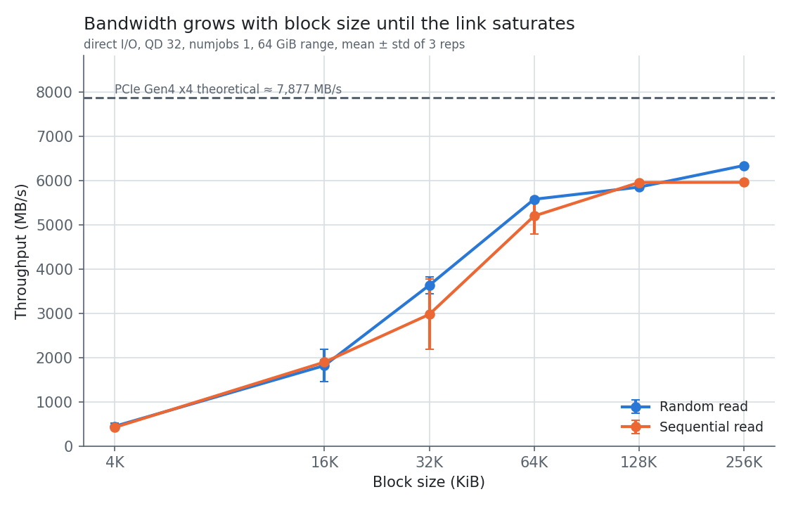

<p align="center" class="figure-caption"><em>Figure 1. Bandwidth vs block size.</em></p>

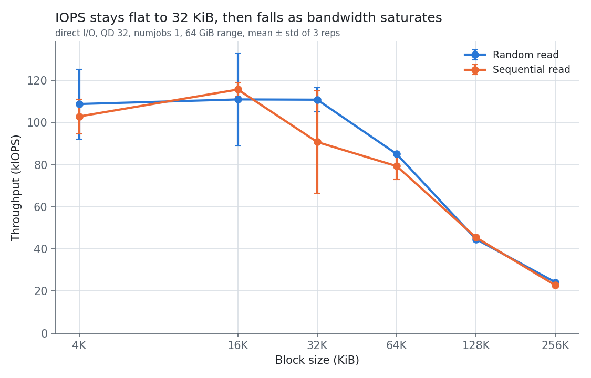

<p align="center" class="figure-caption"><em>Figure 2. IOPS vs block size.</em></p>

The results show two main patterns. Little's Law helps explain the difference:

- **Small blocks (4–32 KiB) are operation-bound.** IOPS is constant, so bandwidth grows in proportion to block size. Only 21–28 of the 32 requested I/Os are actually outstanding: the single submitting thread, not the drive, sets the rate (see *Peak throughput*).
- **Large blocks (64–256 KiB) are bandwidth-bound.** L reaches the full 32, so the queue is always full. Bandwidth levels off at 5.6–6.3 GB/s, 71–80% of the 7,877 MB/s theoretical Gen4 x4 limit, and IOPS falls in inverse proportion to block size.
- **Latency follows the same split.** It rises slowly while operation-bound, then roughly doubles per block-size doubling once each request carries more data than the link can move at queue depth 32.

Random and sequential reads followed the same overall trend, although the difference varied with block size. Flash has no mechanical seek time, so the pattern of access generally matters less than it does on a hard disk. At 256 KiB, random reads were slightly faster than sequential (6.34 vs 5.96 GB/s). That difference is reproducible across the 3 runs but is reported as an observation only; a cause is not established. The small-block results carry wide error bars because of CPU-clock variation (see *Limitations*).

## 6. Read/write mix sweep

I then tested a mix of reads and writes. With four jobs, the mixed workloads matched or slightly exceeded the IOPS predicted from the pure workloads, rather than falling below it as I expected. The excess is within about one standard deviation, so I do not claim a real gain. Read p99, however, increased by about 70%. With one job, the host limit made the effect of the mix impossible to separate.

**What I expected:** mixed workloads underperform the average of pure read and pure write. **Test settings:** 4 KiB random, direct I/O, 64 GiB range, 3 runs per point. Run at two settings: QD 32 × 1 job, and QD 16 × 4 jobs (64 outstanding).

| Mix (read/write) | Total kIOPS, 1 job | Total kIOPS, 4 jobs | Expected, 4 jobs\* | Read p50, 4 jobs (µs) | Read p99, 4 jobs (µs) | Write p99, 4 jobs (µs) |
| --- | --- | --- | --- | --- | --- | --- |
| 100/0 | 126.4 ± 1.0 | 286.6 ± 96.9 | — | 154 | 495 | — |
| 70/30 | 107.2 ± 15 | 276.6 ± 20 | 251–259 | 143 | 851 | 472 |
| 50/50 | 110.4 ± 2 | 264.6 ± 22 | 231–240 | 134 | 786 | 853 |
| 0/100 | 92.6 ± 10.0 | 194.1 ± 28.0 | — | — | — | 810 |

\*Range between the weighted arithmetic mean (per operation) and weighted harmonic mean (per unit time) of the pure-read and pure-write IOPS.

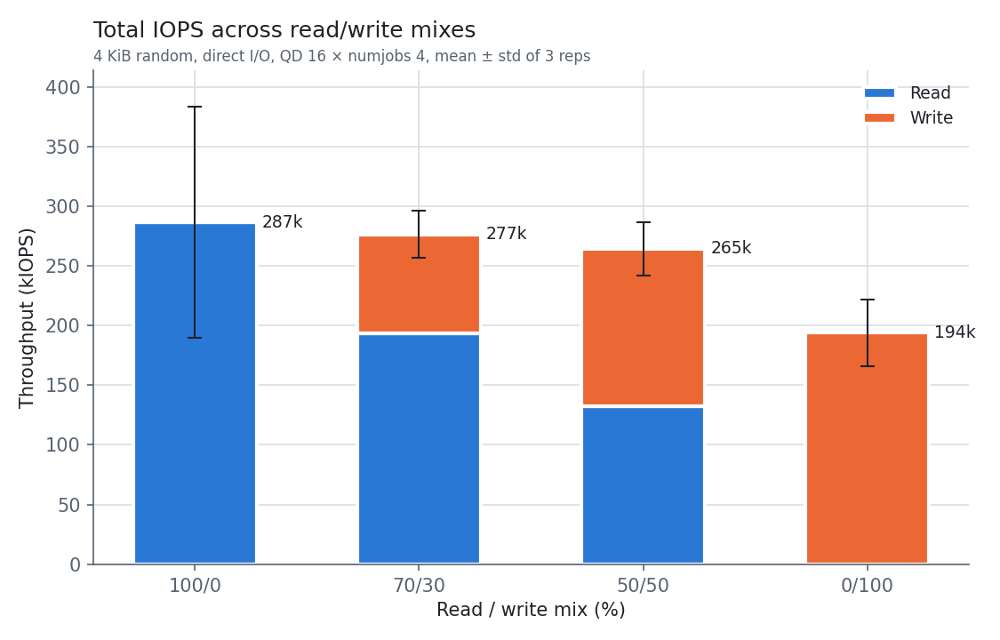

<p align="center" class="figure-caption"><em>Figure 3. Total IOPS per read/write mix, 4 jobs x QD 16.</em></p>

- **With 1 job, the hypothesis cannot be tested.** All four mixes sit at 93–126k IOPS, close to the ~115–125k single-thread ceiling, and the measured mixes fall within error of both predictions.
- **With 4 jobs, my hypothesis was not supported.** The 70/30 and 50/50 mixes measured 276.6 ± 20k and 264.6 ± 22k IOPS, 7–15% above the predicted ranges. The excess is roughly one standard deviation of the measurement, and the prediction itself inherits the ±97k spread of the 100% read point. With three runs, the data show that mixes did not underperform, but they do not establish that mixes outperform. If the small excess is real, one possible reason is that writes are absorbed by the controller's write cache while reads go to flash, so a mix keeps more internal resources busy. The clearer result is that 50/50 delivered 36% more IOPS than pure writes.
- **Tail latency became worse with mixed I/O.** The read median falls slightly as writes are added (154 → 134 µs), but read p99 rises 59–72% (495 → 786–851 µs). Most reads are unaffected, while a few wait behind write activity such as cache flushes or flash programming.
- **Writes have heavier tails than reads.** At 1 job, pure-write p99 was 597 µs against 286 µs for pure reads.

The 100% read point at 4 jobs has a large spread (±97k) because of CPU-clock variation, so comparisons against it are approximate.

## 7. Queue-depth sweep, knee and Little's Law

The queue-depth sweep helped me find the point where adding more requests stopped helping. With one FIO job, that point was around QD 16: about 117,000 IOPS at 111 µs mean latency. Beyond that, doubling QD roughly doubled latency while throughput stayed flat or dropped.

**What I expected:** IOPS rises roughly linearly at low QD and flattens at the knee, after which latency grows roughly linearly with QD. **Test settings:** 4 KiB random read, 1 job, direct I/O, 64 GiB range, 3 runs per point.

| QD | kIOPS | Mean (µs) | p99 (µs) | Measured L | L / QD |
| --- | --- | --- | --- | --- | --- |
| 1 | 11.1 | 90 | 148 | 1.0 | 100% |
| 2 | 21.0 | 93 | 134 | 2.0 | 98% |
| 4 | 39.9 | 95 | 142 | 3.8 | 94% |
| 8 | 79.4 | 93 | 142 | 7.4 | 92% |
| 16 | 117.1 | 111 | 180 | 13.0 | 81% |
| 32 | 113.7 | 187 | 328 | 21.0 | 66% |
| 64 | 111.8 | 339 | 654 | 37.0 | 58% |
| 128 | 104.5 | 678 | 1,472 | 68.8 | 54% |
| 256 | 100.3 | 1,333 | 2,867 | 132.8 | 52% |

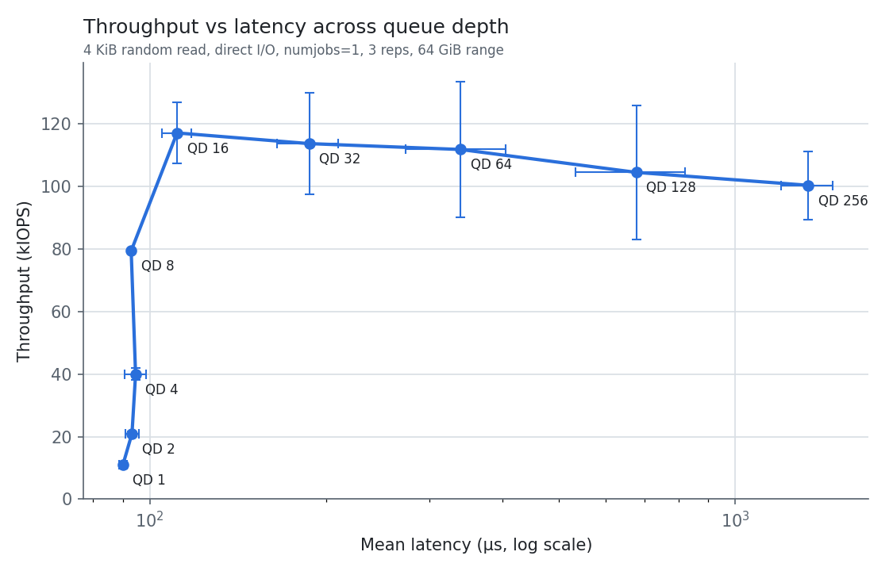

<p align="center" class="figure-caption"><em>Figure 4. Throughput vs latency across queue depth.</em></p>

The curve followed the overall shape I expected, with three clear regions:

- **QD 1–8: more requests improve throughput.** IOPS roughly doubled with QD while mean latency stayed near 90–95 µs. This is consistent with the drive handling requests in parallel without a large increase in queueing.
- **QD 16: the knee.** IOPS reaches its maximum and latency has risen only ~20%. This is the best operating point for one thread: near-peak throughput with near-floor latency.
- **QD 32–256: pure queueing.** Each doubling of QD doubles mean latency and more than doubles p99, with no throughput gain. Extra requests only wait in line.

**The Little's Law check pointed to a host-side limit.** Up to QD 8, the measured outstanding I/O L = IOPS × mean latency matches the requested depth. Past the knee it falls to about half: at QD 256 only ~133 requests are in flight. The gap is consistent with time spent processing completions and submitting new requests, during which those queue slots are not occupied. The measurements do not directly locate every source of delay. FIO's system CPU rose from 7% at QD 1 to ~60–63% from QD 16 onward. Both point to the submitting thread as the bottleneck, which the next section confirms.

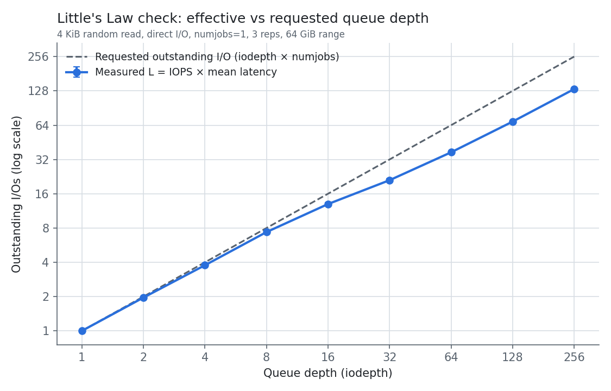

<p align="center" class="figure-caption"><em>Figure 5. Little's Law check: measured vs requested outstanding I/O.</em></p>

IOPS past the knee also varied strongly between runs: the third run was consistently 15–35% slower at QD ≥ 16. This was later traced to the CPU clock dropping during long runs, not to the SSD.

This knee belongs to the single-thread configuration, not to the SSD. A drive-level throughput–latency curve would need the same sweep with several jobs (for example 8 jobs at QD 1–64 each). I did not run that sweep, so the drive's own knee is not identified in this report.

## 8. Peak throughput and the host bottleneck

To check the host bottleneck, I repeated the tests with more FIO jobs. Random-read throughput rose from about 115,000 IOPS with one job to 553,000 with eight jobs, with a best run of 601,000. Sequential reads reached 6,919 MB/s. This confirms that the earlier single-job knee was a host limit. These tests did not establish the SSD's maximum random-read rate.

**What I expected:** one submitting thread cannot saturate the drive; several jobs are needed for peak IOPS. **Test settings:** direct I/O, 64 GiB range, 3 runs per point, shuffled order, CPU clock logged every 5 s.

| Workload | QD per job | 1 job | 2 jobs | 4 jobs | 8 jobs |
| --- | --- | --- | --- | --- | --- |
| 4 KiB random read (kIOPS) | 32 | 115 ± 14 | 187 ± 35 | 328 ± 95 | 553 ± 80 |
| 4 KiB random read (kIOPS) | 128 | 108 ± 9 | 216 ± 14 | 348 ± 84 | 454 ± 6 |
| 128 KiB sequential read (MB/s) | 8 | 5,430 ± 32 | 5,551 ± 25 | 6,919 ± 282 | — |
| 128 KiB sequential read (MB/s) | 32 | 5,962 ± 13 | 6,449 ± 555 | 6,569 ± 512 | — |

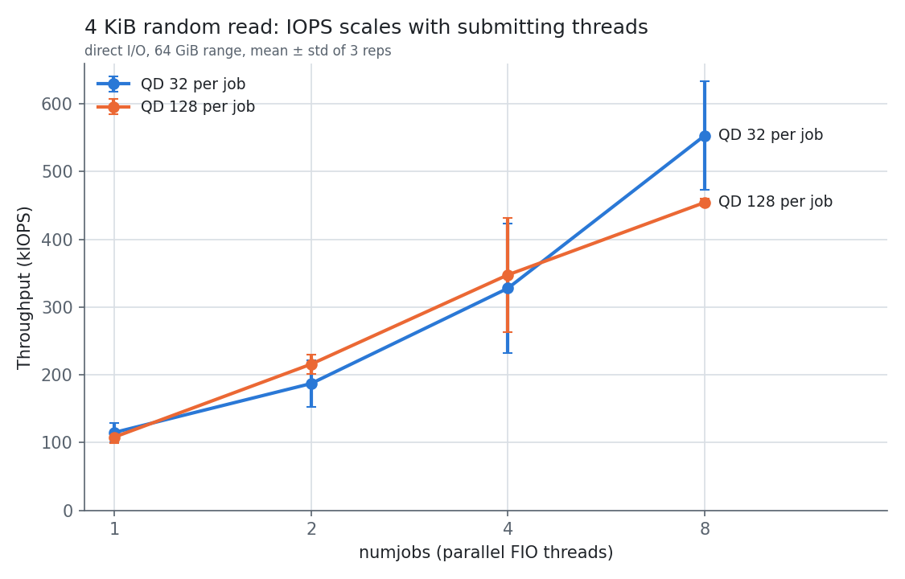

<p align="center" class="figure-caption"><em>Figure 6. 4 KiB random-read IOPS vs number of jobs.</em></p>

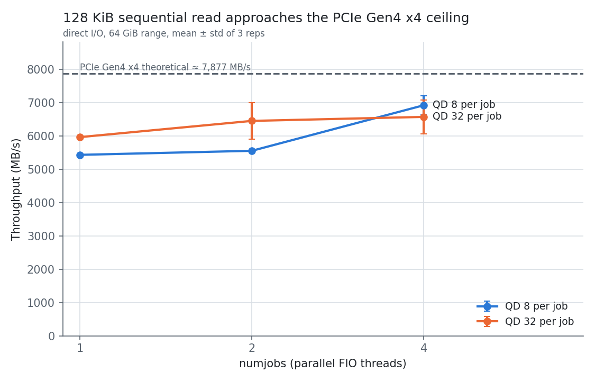

<p align="center" class="figure-caption"><em>Figure 7. 128 KiB sequential read vs number of jobs, with PCIe Gen4 x4 ceiling.</em></p>

The results supported this expectation:

- **Random IOPS scales with threads**, still rising at 8 jobs. Each thread contributes roughly 100–120k IOPS at first, with diminishing returns beyond 2 jobs. Those diminishing returns may come from scheduling onto slower efficiency cores of this hybrid CPU or from the device beginning to saturate; the data cannot separate the two. Testing 12–16 jobs, and pinning jobs to performance cores, would be needed to find the drive's random-read limit.
- **Over-queueing hurts.** At 8 jobs, QD 128 per job (1,024 outstanding) gave less throughput than QD 32 per job (256 outstanding), and p99.9 rose from 4.3 ms to 10.8 ms.
- **Sequential reads approach the interface ceiling.** 6.9 GB/s is 88% of the 7,877 MB/s theoretical Gen4 x4 rate. The write burst in Section 10.2 peaked at a similar 6.76–6.78 GB/s, so both directions top out near 6.8–6.9 GB/s on this platform. That shared ceiling is consistent with PCIe and NVMe protocol overhead below the theoretical rate, but I did not measure the overhead directly. The drive is Gen5-capable, so the Gen4 link limits it. Beyond 32 outstanding requests, latency quadruples with no throughput gain.

**CPU clock explains run-to-run variation.** During this experiment, the laptop CPU clock ranged from 3.3 to 5.25 GHz. Each run's IOPS, relative to the mean of the same setting, correlates with the average clock during that run:

- 4 KiB random read: r = 0.75 over 24 runs. Runs at ~3.3 GHz delivered only ~70% of their setting's mean.
- 128 KiB sequential read: r = 0.28 over 18 runs, effectively independent of clock.

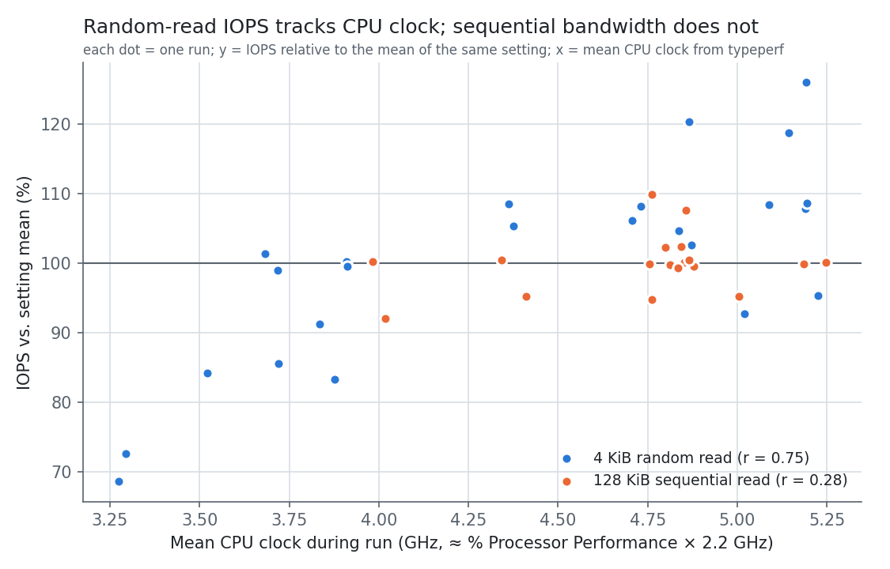

<p align="center" class="figure-caption"><em>Figure 8. Per-run IOPS vs CPU clock.</em></p>

Small-block IOPS on this setup is CPU-bound, while large-block bandwidth is interface-bound. SMART monitoring showed no recorded SSD thermal throttling: the throttle counters stayed at 0, and the hottest sensor remained below about 60 °C. This supports the host-bottleneck explanation, although it does not rule out every possible device-side effect.

## 9. Tail latency

Average latency does not show how slow the worst requests become, so I also ran longer tests for tail latency. From QD 4 to QD 16, throughput increased about 2.5×, the median rose 28%, and p99.9 rose 70%. At QD 64, all reported percentiles were much higher.

**What I expected:** near the knee, p99 and p99.9 grow much faster than p50 because of queueing. **Test settings:** 4 KiB random read, 1 job, direct I/O, 64 GiB range, 120 s runs, 3 runs per point. QD 4 is mid-curve, QD 16 the knee, QD 64 past the knee.

| QD | Position | kIOPS | p50 (µs) | p95 (µs) | p99 (µs) | p99.9 (µs) | p99.9 / p50 |
| --- | --- | --- | --- | --- | --- | --- | --- |
| 4 | Mid | 49.7 ± 0.2 | 73 | 100 | 115 ± 0.6 | 242 ± 7 | 3.3× |
| 16 | Knee | 123.6 ± 2.0 | 94 | 140 | 164 ± 5 | 410 ± 21 | 4.4× |
| 64 | Past knee | 104.7 ± 0.9 | 334 | 627 | 752 ± 13 | 1,281 ± 25 | 3.8× |

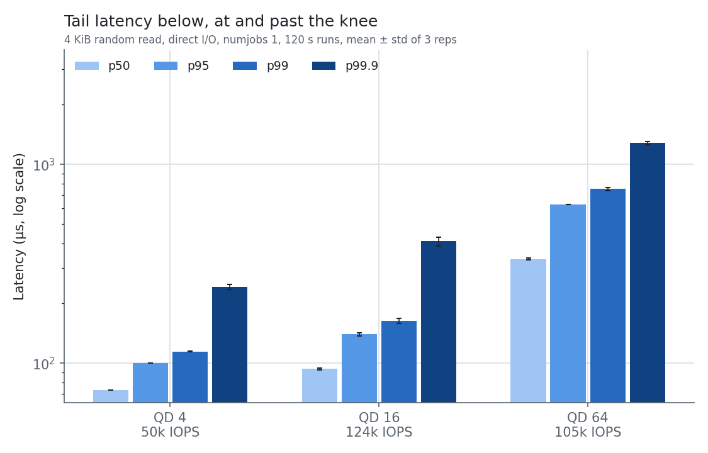

<p align="center" class="figure-caption"><em>Figure 9. Latency percentiles at QD 4, 16 and 64.</em></p>

- **Mid to knee: the tail grows first.** The extra throughput is bought with occasional queueing. The higher p99.9 suggests that a small share of requests experienced longer delays before the median changed as much. The test does not show exactly where those delays occurred inside the drive or host.
- **Past the knee: everything queues.** Throughput falls 15% and every percentile rises 3.1–4.6×. Latency is now dominated by waiting time, consistent with Little's Law: more outstanding requests at constant throughput must mean proportionally longer waits.
- **Practical consequence.** For a request that touches many I/Os, such as a database query or page load, the slowest one sets the response time. Operating at QD 16 rather than QD 64 cuts p99 4.6× for 18% more throughput, so running past the knee gives strictly worse results on both measures.

These positions are relative to the single-thread curve, whose knee is set by the host (Section 8). Tail latency near the drive's own knee, with several jobs, was not measured.

The 120 s tail tests had a smaller spread in p99 (±0.6–13 µs) than the earlier QD 1 baseline (±94 µs). Longer runs provide more samples for rare delays, although these tests also used different queue depths, so run length alone does not explain the difference. Other tail observations appear in the mix section (writes added to reads raise read p99 ~70%) and in the peak section (over-queueing at 8 jobs pushes p99.9 to 10.8 ms).

## 10. Working set and device state

I checked whether performance changed with the working-set size and the drive's recent write activity. Changing the tested range from 1 to 64 GiB did not produce a clear latency difference. Sustained writes had a much larger effect: after about 27 GB, bandwidth dropped by roughly 3.7× and latency rose about 4×, consistent with exhaustion of the fast write cache.

### 10.1 LBA range (working set)

**What I expected:** small ranges fit the controller's address-mapping cache and show lower latency. **Test settings:** 4 KiB random read, 1 job, 3 runs per point; run at QD 32 and again at QD 1.

| Range | Mean at QD 1 (µs) | p99 at QD 1 (µs) | Mean at QD 32 (µs) |
| --- | --- | --- | --- |
| 1 GiB | 71.7 ± 3.2 | 116 ± 13 | 186 ± 22 |
| 4 GiB | 71.0 ± 0.7 | 113 ± 4 | 182 ± 27 |
| 16 GiB | 72.3 ± 2.5 | 121 ± 10 | 159 ± 0.5 |
| 64 GiB | 74.5 ± 4.9 | 177 ± 89 | 173 ± 18 |

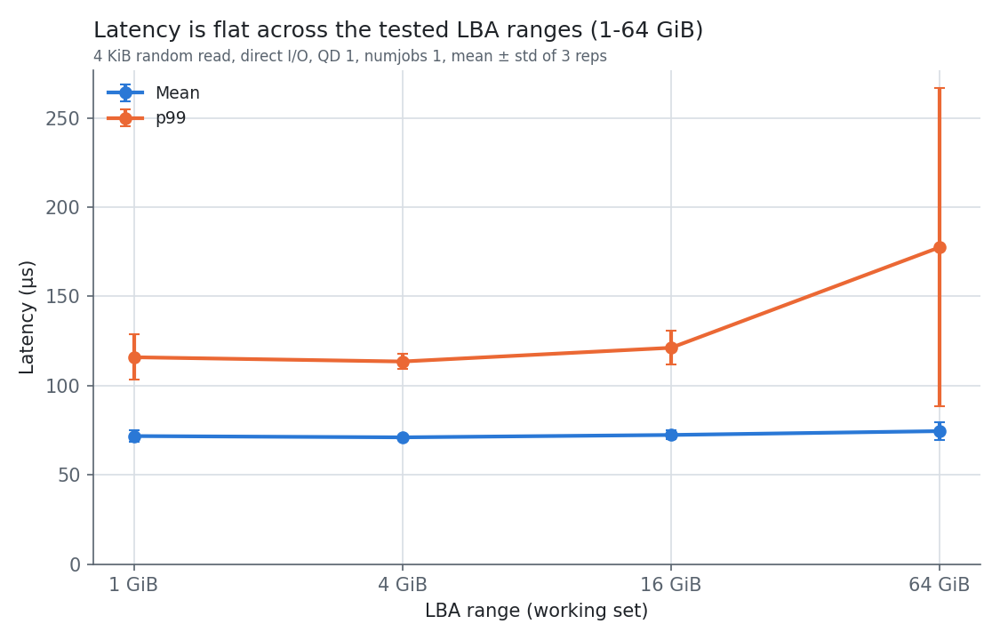

<p align="center" class="figure-caption"><em>Figure 10. Latency vs LBA range at QD 1.</em></p>

The hypothesis was not supported in the tested range. Latency is flat within error at both depths; at QD 32 the variation is CPU noise, so QD 1 is the cleaner test. The logical-to-physical mapping for 64 GiB at 4 KiB granularity is about 16 M entries, roughly 64 MiB at 4 bytes per entry. The flat results are consistent with the mapping cache covering this range, but they do not prove its size or design. Showing a working-set effect would need a range spanning much more of the 2 TB drive, which the test-file approach did not reach.

### 10.2 Burst versus steady state

**What I expected:** bandwidth drops sharply once the SLC write cache fills, then settles at a steady state. **Test settings:** 128 KiB sequential write, QD 32, 1 job, 240 s, bandwidth and latency logged every second; 595 GB written in total.

| Phase | Time | Write bandwidth | Mean latency |
| --- | --- | --- | --- |
| Burst | 0–4 s (~27 GB) | 6,760 MB/s | ~580 µs |
| Cache exhausted | from 5 s | ~1,800 MB/s | ~2,300 µs |
| Recovery bursts | near 45, 100, 143, 183 and 218 s | briefly ~6,700 MB/s | ~400–600 µs |
| Whole run | 240 s | 2,481 MB/s average | 1,617 µs (p99 4.4 ms, max 35 ms) |

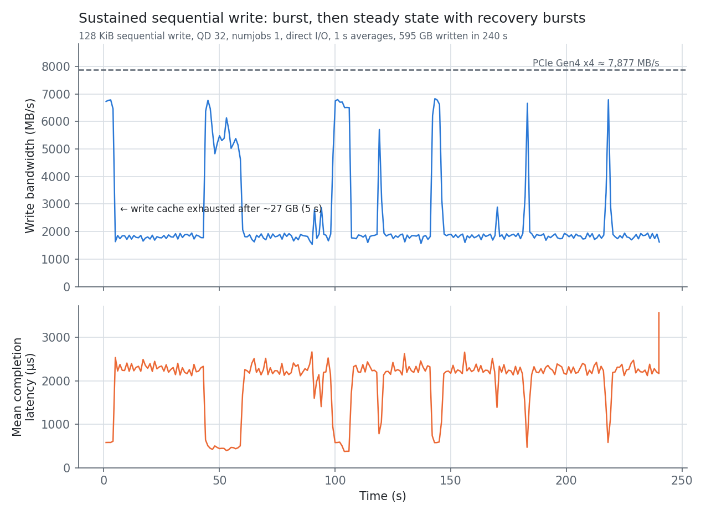

<p align="center" class="figure-caption"><em>Figure 11. Sustained write bandwidth and latency over time.</em></p>

The results supported this expectation:

- **The burst runs at the link limit.** Little's Law agrees: 32 × 128 KiB / 580 µs ≈ 7.2 GB/s.
- **The slower phase was around 1.8 GB/s.** This is consistent with the fast write cache being exhausted and performance depending more on main-flash programming and cache management. The test does not directly measure the controller's internal write path.
- **The recovery bursts are likely background cache reclamation.** The controller migrates cached data to main flash, freeing space for a few seconds of fast writes. The bursts shrink from ~15 s to 2–3 s over the run, so the drive is converging toward pure steady state.
- **Not thermal.** Temperature stayed below ~60 °C on the hottest sensor and all thermal-throttle counters remained 0.

**Recent write history may change the burst size.** Prep pass 2, after the drive had been idle, wrote 64 GiB at 5.2 GB/s with no drop. This run came after ~190 GB of writes in the previous 90 minutes, the last ending 7 minutes earlier, and its burst lasted only ~27 GB. One explanation is that the cache had not finished draining. The two runs also differ in block size (1 MiB vs 128 KiB) and queue depth (16 vs 32), and each was run once, so this is a suspicion rather than a demonstrated effect. Repeating this test after the drive has rested for an hour or more would settle it.

## 11. Misleading setups

During the project, I found three setups that produced misleading results, and suspect a fourth. I deliberately tested buffered I/O to show the cache effect. The next two came up during testing and were confirmed with additional checks. The fourth is an observation that I could not test in a controlled way.

### 11.1 Buffered I/O (page-cache effect)

The same 4 KiB random read at QD 1 was run with direct I/O and with Windows' file cache enabled, over a small region.

| Setup | IOPS | Mean (µs) | p50 (µs) | p95 (µs) | p99.9 (µs) |
| --- | --- | --- | --- | --- | --- |
| Direct, 1 GiB region | 15,239 | 65.3 | 62.7 | 74.9 | 298 |
| Buffered, 1 GiB region, 10 s warm-up | 52,609 | 18.8 | 12.3 | 76.3 | 126 |
| Direct, 256 MiB region | 11,398 | 87.4 | 83.5 | 101.9 | 364 |
| Buffered, 256 MiB region, 30 s warm-up | 72,669 | 13.6 | 12.3 | 20.1 | 47 |

With the warmer 256 MiB cache, buffered reads appeared 6.4× faster on average and about 5× faster at p95. These results are consistent with most reads being served from RAM, leaving mainly the overhead of the Windows I/O path. With a partly warm cache, the speed-up was only 3.5×, and p95 stayed at disk speed. The apparent "SSD performance" thus depends on cache warmth, not the device. On a 64 GB RAM machine, a buffered benchmark can report RAM speed for most realistic file sizes.

### 11.2 Wrong effective queue depth (file extension)

The first fill of the test file wrote 64 GiB at 2,833 MB/s with QD 16 requested. Little's Law gave L = 2,701 IOPS × 3.26 ms = 8.8, only half of the requested 16. Re-running on the existing file gave 5,174 MB/s and L = 15.7. NTFS serialises part of the asynchronous writes that extend a file. Benchmarks that write to a new or growing file under-report bandwidth and do not run at the queue depth they claim.

### 11.3 Host-bound "knee" mistaken for the SSD's

With one FIO thread, the QD sweep shows a clean knee at QD 16 and ~117k IOPS. Read naively, this is the SSD's saturation point. Three pieces of evidence show it is the host's:

- Little's Law: L reaches only ~50% of the requested QD past the knee.
- Scaling: IOPS rises to 553k with 8 threads.
- CPU clock: IOPS correlates with the clock (r = 0.75), while sequential bandwidth does not (r = 0.28).

### 11.4 Suspected test-order dependence of write results (not controlled)

The drive wrote 64 GiB with no slowdown when idle, but gave only ~27 GB of burst after 90 minutes of heavy writes (see *Burst versus steady state*). If this is caused by write history, a write benchmark run straight after other write tests would under-report burst capacity. However, the two runs used different block sizes and queue depths and were each run once. Confirming the pitfall would need the same `steady` test repeated on a rested drive and on a recently written one.

## 12. Anomalies

I kept track of results that were unexpected or inconsistent between runs instead of removing them. Appendix A lists all 15 with their data, likely causes and handling. The four that most affect how the results should be read are:

- **QD 1 latency varies between sessions** (65–90 µs), so the baseline is a range rather than a single number (Section 4).
- **The same workload gave different IOPS in different experiments.** 4 KiB random read at QD 32 with one job measured 108.8k, 116.9k and 126.4k in three sessions, so comparisons are only made within one session.
- **Outstanding I/O was only about half of the requested QD past the knee**, which revealed the host bottleneck (Sections 7–8).
- **The write burst was much shorter in the sustained-write run than during preparation**, which may reflect recent write history (Section 11.4).

## 13. Limitations

The biggest limitation was the changing CPU frequency. It contributed to substantial variation in the small-block, high-QD tests, with some runs differing by about 10–30%. This makes within-session comparisons more useful than treating every number as a fixed specification for the drive.

| Limitation | Effect on results | Mitigation |
| --- | --- | --- |
| No administrator rights | CPU frequency, Defender scanning and power states could not be controlled | High-performance plan; CPU clock logged; shuffled order; mean ± std over 3 runs |
| Variable CPU clock (3.3–5.25 GHz) | Small-block IOPS varies with clock (r = 0.75); QD 1 latency drifted 65–90 µs between batches | Reported as a confounder with per-run correlation, not hidden |
| OS on the tested drive | Background Windows I/O adds noise, mostly to p99/p99.9 | Repeated runs; longer 120 s runs for tail latency |
| NTFS file, not raw device | Small filesystem overhead; file extension serialises writes (misleading setup 2) | All measurements on a pre-written file |
| Working set limited to 64 GiB (~3% of the drive) | Cannot show mapping-cache misses across the full LBA space | Stated as untested beyond 64 GiB |
| Single steady-state run | One 240 s run cannot give an error bar; the effect of write history on burst size is uncontrolled | Write history before the run documented; pitfall 11.4 labelled as suspected |
| Drive-level knee not reached | Random-read IOPS still rising at 8 jobs; the identified knee and the tail-latency points belong to the single-thread curve | Stated in Sections 7–9; a multi-job QD sweep is listed as future work |
| No write-side block-size or QD sweep | Write behaviour is characterised only at QD 1, in the mix sweep and in the sustained write | Stated as untested |
| QD 1 baseline varies between sessions | 4 KiB random-read latency ranged 65–90 µs across five sessions | All sessions reported in Section 4 |
| No continuous temperature log | "Not thermal" rests on before/after SMART readings and zero throttle counters | Throttle counters cover the whole period |
| Gen4 link on a Gen5 drive | Sequential results reflect the platform link, not the drive's rated ~11 GB/s | Link speed verified idle and under load |
| Hybrid CPU (performance and efficiency cores) | FIO threads may be scheduled on slower cores, limiting multi-thread scaling | Not controlled; noted as a possible cause of sub-linear scaling |
| Laptop thermals | Possible CPU throttling during long runs | SSD throttling ruled out by SMART counters; CPU effect measured |

## 14. Reproducibility

The repository stores the FIO job files, raw JSON results, and settings used for each run. These files make it possible to repeat the experiments and check the calculations. Exact results may still differ because CPU frequency, background activity, and drive state were not fully controlled.

| Path | Contents |
| --- | --- |
| `scripts/ssdbench.py` | Runs every experiment (`list`, `run`, `parse`, with `--help`); generates job files and enforces safety checks |
| `scripts/run_job.ps1`, `jobs/*.fio` | Alternative PowerShell runner and the first static job files |
| `results/raw/<experiment>/<session>/` | Generated `.fio`, one JSON per run, `manifest.json` (all settings, FIO version, timestamps), per-second logs for the sustained write |
| `results/raw/*_cpu_log.csv` | CPU clock logged with `typeperf` |
| `results/processed/` | `summary.csv` (per run) and `summary_agg.csv` (mean ± std per setting) |
| `analysis/` | `parse_fio.py`, `plot_qd.py`, `plot_peak.py`, `plot_sweeps.py`, `plot_steady.py` |
| `figures/` | All plots in this report |
| `env/` | System information and CrystalDiskInfo SMART screenshots before and after each batch |

To reproduce, from the repository root on Windows:

```
python scripts\ssdbench.py run prep
python scripts\ssdbench.py run all --shuffle
python scripts\ssdbench.py run steady --runtime 240 --yes
python scripts\ssdbench.py parse
python analysis\plot_qd.py; python analysis\plot_peak.py; python analysis\plot_sweeps.py; python analysis\plot_steady.py
```

The follow-up runs used `run sanity --sanity-size 256M --ramp 30 --tag warmcache`, `run mix --qd 16 --numjobs 4 --tag nj4`, `run range --qd 1 --tag qd1` and `run tail --qd 4,16,64`. In total the project wrote roughly 1 TB and read roughly 11 TB. The writes are about 0.1% of the ~1,200 TB endurance typical of comparable retail 2 TB drives; Samsung does not publish a rating for this OEM model.

## 15. Conclusion

The main lesson from this project is that an SSD benchmark measures the whole I/O path, not only the drive. With one FIO thread, the queue-depth sweep showed a clean knee that looked like the SSD's limit. Little's Law, the numjobs grid and the CPU-clock log showed it was the host's. Large sequential transfers behaved differently: they reached about 88% of the PCIe Gen4 x4 rate and were barely affected by the CPU clock.

The drive itself delivered a QD 1 read latency of 65–90 µs, more than 550,000 random-read IOPS with eight jobs, about 6.9 GB/s of sequential read, and a write burst that fell from 6.8 to 1.8 GB/s once its fast cache was full. Tail latency grew faster than the median as the queue filled, and mixing writes into reads raised read p99 by about 70% even though throughput held up.

If I repeated the project, I would pin FIO threads to performance cores, run the queue-depth sweep with several jobs to find the drive's own knee, add a write-side sweep, log temperature continuously, and repeat the sustained-write test on a rested drive.

## 16. AI-use note

I used Claude, an AI assistant from Anthropic, throughout this project. It wrote nearly all of the code, helped draft the report and README, and later reviewed the report at my request and revised it to address that review. I also used an OpenAI assistant to revise the wording, formatting, and section numbering in this version. I ran every experiment on my own laptop, and every number reported here comes from the raw FIO output stored in the repository. The AI read those result files directly from my project folder through a linked-computer connection and ran the parsing and plotting scripts on them.

### 16.1 Division of work

| Stage | What the AI did | What I did |
| --- | --- | --- |
| Learning | Explained the terminology (IOPS, queue depth, Little's Law, FTL, SLC cache, tail latency) and the learning goals | Asked questions and chose what to study |
| Platform choice | Compared WSL, native Windows and a live Linux USB; recommended native Windows FIO for the SSD | Ran the `perf` test showing WSL exposes no hardware counters; chose the setup |
| Setup | Gave install, PATH, `typeperf` and Git commands | Installed FIO, Python and CrystalDiskInfo; ran every command; reported errors back |
| Code | Wrote `ssdbench.py`, `run_job.ps1`, the job files, `parse_fio.py` and the four plotting scripts, and tested them with dry runs | Ran them; did not write code myself |
| Experiment design | Proposed the experiment matrix, hypotheses and follow-ups (warm-cache sanity, 4-job mix, QD 1 range, CPU logging) | Ran all experiments, kept the machine idle and plugged in, took SMART screenshots, decided to run the sustained-write test after asking about drive wear |
| Analysis | Computed summaries, Little's Law checks and the CPU-clock correlation; wrote interpretations | Reviewed the results as they came in |
| Writing | Drafted this report and the README; reviewed the draft and revised it (softer claims, cross-session baseline table, conclusion, appendix) | Reviewed, edited and finalised them |

### 16.2 AI errors found during the project

The AI's suggestions were not always correct. The table below shows the mistakes that came up, how they were identified, and what changed afterward.

| # | What the AI got wrong | How it was caught | Outcome |
| --- | --- | --- | --- |
| 1 | Predicted a 10–100× buffered-I/O speed-up | Measured 3.5×, then 6.4× with a warm cache | Hypothesis reported as wrong |
| 2 | Its first sanity-test design (1 GiB region, 10 s warm-up) left the cache only partly warm | p95 stayed at disk speed | Re-run with 256 MiB and 30 s warm-up |
| 3 | Predicted that mixed workloads underperform | Measured 7–15% above prediction at 4 jobs, within about 1 std | Hypothesis reported as not supported |
| 4 | Predicted lower latency for small LBA ranges | Flat latency at QD 1 and QD 32 | Hypothesis reported as not supported |
| 5 | Did not anticipate that writing a new file would cut the effective queue depth | Little's Law gave L = 8.8 instead of 16 | Second prep pass; documented as a misleading setup |
| 6 | Estimated the SLC cache at hundreds of GB, needing 0.5–1.2 TB of writes to exhaust | Burst lasted only ~27 GB | Result reported as measured |
| 7 | Initially read the wrong SMART fields: reported 97 GB written and 5.9 TB read for one batch | CrystalDiskInfo's summary and raw table disagreed | Corrected to 91 GB and 5.4 TB; logged as anomaly 15 |
| 8 | Gave commands that failed on my system: `&&` in Windows PowerShell 5.1, a `typeperf` relative path run from the wrong folder, and PATH changes that did not reach my open terminal | The commands errored | Corrected commands given |
| 9 | Produced plots with overlapping titles and labels, and two script bugs found in its own dry runs | Its own review of rendered plots and test runs | Fixed before data collection or publication |
| 10 | The first report draft overstated two results (mixed workloads "refuted" the hypothesis; test-order dependence "demonstrated") and cited an unsourced "practical ~7 GB/s" limit | A review of the draft that I asked the AI to do | Wording softened, claims tied to the data, missing experiments listed as limitations |

### 16.3 Claims that rest on the AI's judgement

- Explanations marked *likely* or *possible* (the steady-state recovery bursts, the mixed-workload result, the burst size depending on write history) are the AI's interpretations of the data and were not independently verified.
- The ~1,200 TB endurance figure is assumed from comparable retail 2 TB drives; Samsung does not publish one for the PM9E1.
- Comparisons with rated drive speeds rely on public benchmark pages, not a manufacturer specification.

## Appendix A. Full anomaly log

Inferred causes should be read as explanations supported by the measurements, rather than direct proof.

| # | Anomaly | Data | Likely cause | Handling |
| --- | --- | --- | --- | --- |
| 1 | QD=1 random-read latency drifted between batches | 65–68 µs (`qd1`, `sanity` direct), 87–90 µs (`qd`, `sanity` warm-cache), 71–75 µs (`range --qd 1`) | CPU clock and power state varied (3.3–5.25 GHz); host overhead is part of QD=1 latency | Reported as a limitation; baseline table uses the earliest batch |
| 2 | Third repetition consistently slower in the QD sweep | Run 3 15–35% below runs 1–2 at QD ≥ 16 | CPU clock dropping during long runs; confirmed later by r = 0.75 correlation in `peak` | Later runs logged the CPU clock and used `--shuffle` |
| 3 | One p99 outlier at QD=1 | 4 KiB random read p99: 272 µs in run 1, 102–120 µs in runs 2–3 | Background Windows I/O on the shared system drive | Kept; shown as ± 94 µs error |
| 4 | First prep pass slower than expected | 2,833 MB/s, L = 8.8 at QD 16; second pass 5,174 MB/s, L = 15.7 | NTFS serialises writes that extend a file | Measurements used the pre-written file; documented as misleading setup 2 |
| 5 | Outstanding I/O only ~half of requested QD past the knee | L / QD = 52–66% at QD 32–256 | Single FIO thread cannot reap and resubmit fast enough (host-bound) | Investigated with `peak`; documented as misleading setup 3 |
| 6 | Buffered speed-up far below prediction | 3.5× (1 GiB, 10 s warm-up) vs predicted 10–100×; p95 still at disk speed | Cache only partly warm: random reads had not touched most of the region | Re-run with 256 MiB region and 30 s warm-up: 6.4× |
| 7 | Same workload, different IOPS in different experiments | 4 KiB random read, QD 32, 1 job: 108.8k (`bs`), 116.9k (`range`), 126.4k (`mix` 100/0) | Run-to-run CPU-clock variation | Compare settings only within one session |
| 8 | Very large spread at 100% read, 4 jobs | 286.6k ± 96.9k IOPS | CPU-clock sensitivity grows with thread count | Comparisons against this point flagged as approximate |
| 9 | Mixed workloads at or slightly above the pure-workload average | 70/30 and 50/50 at 4 jobs: +7–15% over prediction | Possibly reads and cache-absorbed writes use different internal resources in parallel; excess is within about 1 std | Hypothesis reported as not supported; gain not claimed |
| 10 | Random reads faster than sequential at 256 KiB | 6,336 vs 5,958 MB/s, both with small std | Not established | Reported as an observation only |
| 11 | Over-queueing reduced throughput | 8 jobs: QD 128 per job 454k IOPS vs QD 32 per job 553k; p99.9 10.8 ms vs 4.3 ms | Excess outstanding I/O adds host and device queueing overhead | Reported under *Peak throughput* and *Tail latency* |
| 12 | One noisy p99 in the range sweep | 64 GiB at QD 1: p99 177 ± 89 µs vs 113–121 µs elsewhere | One slow run (background I/O) | Kept with error bar; mean unaffected |
| 13 | Write burst much shorter than in prep | `steady` burst ~27 GB; prep pass 2 wrote 64 GiB with no drop | *Likely* SLC cache not drained after ~190 GB written in the preceding 90 minutes | Reported as a suspected, uncontrolled pitfall (Section 11.4) |
| 14 | Periodic full-speed bursts during steady-state write | Returns to ~6,700 MB/s near 45, 100, 143, 183 and 218 s; bursts shrink from ~15 s to 2–3 s | *Likely* background migration from SLC cache to main flash frees space briefly | Described under *Burst versus steady state* |
| 15 | SMART readings inconsistent within one screenshot | Summary totals differ from the raw hex table (e.g. reads 8,748 GB vs 8,411 GB); temperature gauge 40 °C vs raw 49 °C | CrystalDiskInfo refreshes the raw table and summary at different times | Data totals taken from the refreshed summary fields; cross-checked against FIO byte counts |
